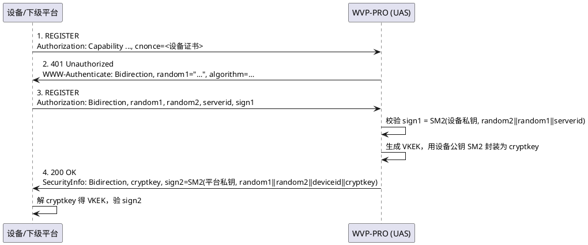
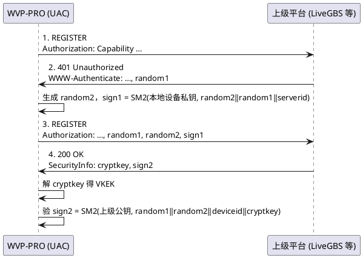

<!-- GB35114 设计说明 -->

# GB35114 设计说明

本平台在 GB28181 的基础上实现了 **GB35114 A 级**（基于数字证书的单向/双向认证）接入与级联，
包括三部分能力：

1. **证书管理** —— 本地 CA、服务端/客户端身份的签发、导入、导出、吊销、换发；
2. **证书注册认证** —— 设备侧（UAS）与平台侧（UAC）两侧的 A 级 REGISTER 握手；
3. **信令完整性认证** —— 非 REGISTER 信令的 `Note`（带密钥杂凑）加签与验签。

> 说明：本文只描述设计取舍与关键时序，逐步操作见 [使用说明](usage.md)，
> 部署与配置见 [安装说明](install.md)。

---

## 一、总体结构

### 1.1 模块划分

新增代码集中在 `com.genersoft.iot.vmp.gb35114` 包下，与既有 GB28181 代码**只通过少数几个集中点耦合**，
避免侵入式改造：

```
com.genersoft.iot.vmp.gb35114
├── conf/       Gb35114Config             YAML 配置绑定（gb35114: 段）
├── crypto/     Gb35114SmCrypto           SM2 / SM3 / VKEK 封装、随机数
│               Gb35114CertUtil           证书/CSR 生成、解析、指纹、身份加载
│               Gb35114HeaderUtil         SIP 头构造与解析（Capability/Authorization/SecurityInfo/Note）
│               Gb35114KeyProtector       私钥落地的 AES-GCM 加解密
├── cert/       bean/     Gb35114Ca、Gb35114Cert
│               dao/      Gb35114CaMapper、Gb35114CertMapper
│               service/  IGb35114CertService + impl
│               controller/ Gb35114CertController（/api/gb35114/cert/**）
└── sip/        Gb35114PlatformStateMachine   UAS 侧握手状态机（本平台作平台）
                Gb35114DeviceStateMachine     UAC 侧握手状态机（本平台作下级）
                Gb35114SecurityService        门面：状态机缓存、证书选择
                Gb35114VkekCache              VKEK 缓存（按对端国标编码）
                Gb35114NoteIntegrator         出站加签 / 入站验签的集中接入点
                Gb35114NoteService            Note 摘要的计算与校验
                Gb35114SipHeaders             jain-sip 原始头读写工具
```

与既有代码的耦合点（全部是**一处接入、全局生效**）：

| 接入点 | 位置 | 作用 |
|---|---|---|
| 出站加签 | `SIPSender.transmitRequest` | 所有出站信令统一注入 `Date` + `Note` |
| 入站验签 | `SIPProcessorObserver.processRequest` | 所有入站请求统一验 `Note`，失败回 403 |
| UAS 注册 | `RegisterRequestProcessor.registerHandler` | 识别国密 `Authorization` scheme，走国密分支 |
| UAC 注册 | `RegisterResponseProcessor` + `SIPCommanderForPlatform` | 处理 401 挑战、校验 200 的 `SecurityInfo` |
| 原始头保留 | `GBStringMsgParser` | 保留解析不了的头，供 Note 验签取回 |
| NIO 通道 | `CustomNioTcpMessageProcessor` | 修补 jain-sip 换 socket 竞态 |
| 启动串行化 | `PlatformServiceImpl` | 启动注销与定时注册串行化 |

### 1.2 为什么不改协议栈

`jain-sip` 是 GB28181 侧共用的协议栈。GB35114 的头部（`Capability`、`Bidirection`、
`SecurityInfo`、`Note`）都不是 RFC3261 标准头，标准解析器会把它们丢弃或解析失败。
因此本项目**不改协议栈的解析逻辑**，而是：

- 出站用 `Gb35114SipHeaders.addRawHeader` 直接拼头，绕过标准头的序列化；
- 入站用 `rawHeaderValue` / `unparsedHeaderValue` 从头字符串里取回。

---

## 二、证书模型

### 2.1 两个正交维度：用途 × 密钥持有方

证书按**用途**（`purpose`）区分，而不是简单地按"服务器/设备"分。因为"服务器证书"
这个词在 UAS 和 UAC 两侧指的是完全不同的东西：

| 用途 | 含义 | 私钥在哪 | 谁在用 |
|---|---|---|---|
| `SERVER_IDENTITY` | 本地服务端证书 | **本平台** | 本平台作 UAS，签 `sign2` |
| `DEVICE_IDENTITY` | 本地客户端证书 | **本平台** | 本平台作 UAC，签 `sign1`（通常由上级签发） |
| `ISSUED_DEVICE` | 下级客户端证书 | 下级 | 本平台签发给下级设备/平台 |
| `TRUSTED_PLATFORM` | 上级服务端证书 | 上级 | 仅公钥，验 `sign2` |

CA 按用途分两类：`LOCAL_CA`（本地根 CA，给本平台自己签发用）、
`TRUSTED_CA`（受信的上级 CA，可多份 —— 多个上级各一份）。

### 2.2 签名身份的本质是密钥对，不是证书

这是整个证书体系的**核心约定**，也决定了后面所有"能并存什么、不能并存什么"的判断：

> 设备只保存平台公钥。同一密钥对签出的多张证书（有效期不同、签发者不同、序列号不同）
> 对设备**完全等价**。

因此：

- **同一个密钥对可以签出多张证书**，这是正常状态，不需要清理，也不能顺延吊销；
- 证书轮换（换有效期 / DN / 签发者而不换密钥）**不打断已配置的设备** —— 设备无需重新导入公钥；
- 但**换密钥对**等于悄悄换掉设备信任的公钥，设备验 `sign2` 必然失败，
  且平台日志上一切正常（确实签了名，只是用错了身份），故障点会漂到设备侧。

`key_fingerprint`（SM3 公钥指纹）就是为这条约定服务的：指纹相同 = 同一个签名身份。
`resolveUsableServerIdentity` 的"同组顺延"逻辑完全建立在这上面，且**绝不跨指纹组顺延**。

### 2.3 三条收敛约束

早期实现里同一逻辑身份可以被无限创建出多份互不相干的记录，导致"设备绑定的是哪一把公钥"
要靠指纹分组去猜。现在用三条约束把证书体系收敛掉：

#### 约束一：本地 CA 只保留一份

`generateCa` / `importCa(LOCAL_CA)` 前调 `assertNoLocalCa()`，已有 `LOCAL_CA` 则拒绝。

**不做自动覆盖**：覆盖式替换会静默改变已签发证书的签发者，与"删除前先校验引用"的安全语义冲突。
轮换路径是**先删旧的、再建新的**（`deleteCa` 已有 `certMapper.countByCaId(id)` 引用守卫）。

守卫报错时**优先点名被引用的那一份**（按 `certMapper.countByCaId` 挑选），而不是最新一份 ——
否则运维会拿到一个"删了也没用"的提示。

`TRUSTED_CA` 不受限制：多个上级 → 多份上级 CA。

#### 约束二：服务端只保留一组密钥对

守卫条件统一为「**存在未吊销的 `SERVER_IDENTITY` 记录**」，加在三处新建入口：

| 入口 | 方法 |
|---|---|
| 创建 CSR | `createPendingCsr` |
| 自签生成 | `generateSelfSigned` |
| 导入证书+私钥 | `importIdentityCert` |

拒绝文案统一指向 `reissueServerIdentity`（**同密钥再签**）—— 它是唯一的换发路径，
天然复用密钥对，不触发守卫。

**守卫挂在"未吊销"上是为了留出应急通道**：密钥泄露 / 私钥丢失时，
先把该组全部吊销，守卫即失效，可以新建第二组。这正是"吊销"该有的语义。

#### 约束三：过期默认不拒绝，只提示

`gb35114.reject-expired-cert`，默认 `false`。

**为什么做成策略而不是硬编码**：A 级握手既不校验证书链也不校验证书有效期，
设备/上级只拿公钥验签。一张刚过期几小时的证书在协议上**仍然可用**；
而按日期直接拒绝会让设备在运维还没反应过来时就被挡在门外，且现场只能翻日志才看得出原因。
默认行为是：证书列表照常标出「已过期」，由运维看到后决定吊销、删除还是重新颁发。

需要严格合规的部署再把此项置为 `true`。

> **吊销不受该开关影响** —— 吊销是运维对该身份的明确停用指令，任何取值下都拒绝。

### 2.4 私钥的存储与保护

| 项 | 做法 |
|---|---|
| 落地加密 | `Gb35114KeyProtector`，AES-GCM，密钥来自 `gb35114.key-encrypt-password` |
| 存储位置 | 与 CSR / 证书**同一条记录**的 `key_pem` 列 |
| 删除语义 | 删除该记录即删除私钥，不留副本 |
| 下发限制 | `keyPem` 标 `@JsonIgnore`，**永不出现在任何 API 响应中**；列表只返回 `hasKey` 布尔值 |
| 导出 | 仅"导出证书"（`cert_pem` 公钥部分）与"导出 CSR"，私钥不提供导出接口 |

---

## 三、A 级注册握手

### 3.1 UAS 侧（本平台作平台，接受下级设备/平台注册）



关键实现点（`Gb35114PlatformStateMachine`）：

- **会话按设备 ID 索引**，`Session` 内 `synchronized`，保证并发重注册安全；
- **幂等重传**：SIP-over-UDP 会重传已完成握手的 REGISTER，
  `verifyRegister` 比对 `lastAuth`，命中则直接返回上次的 `lastSecurityInfo`，不重新协商 VKEK；
- **算法协商**：401 挑战里的 `algorithm` 必须是**从设备上报能力中选出的结果**（标准 §C.3 b)），
  只回内置的 `A:SM2;H:SM3` 会让协商结果与设备预期不符；`200 OK` 的 `SecurityInfo` 里也必须回同一个串；
- **`serverid` 取 `sip.id`**（平台国标编码），不是 `userSetting.serverId`（那是集群内节点标识，默认 `000000`）。
  设备签名 `sign1` 时用的就是 `sip.id`，两者必须一致，否则报 `server id mismatch`；
- **设备证书的最后一道校验**：设备会在 `Capability` 的 `cnonce` 里**自报证书**，这条路径不过数据库。
  因此 `certValidator` 必须对**所有来源**（预置 / 自报 / 数据库）的证书做吊销与过期校验 ——
  否则一台被吊销的摄像头只要自报旧证书就能重新接入，吊销形同虚设。

### 3.2 UAC 侧（本平台作下级，向上级平台注册）



关键实现点（`Gb35114DeviceStateMachine`）：

- **`serverid` 允许缺失**：部分平台（如 LiveGBS）在 200 OK 里不回它。它不携带新信息 ——
  本次 REGISTER 的目的地已唯一确定平台编码，缺省即"就是它"；对端回了则必须一致。
- **状态机按 `serverId|deviceCertId|platformCertId` 复合键缓存**，证书配置变化时重建，
  避免复用旧证书签出的握手状态。

### 3.3 平台侧证书的选择顺序

`Gb35114SecurityService.resolveServerCertId` 决定 UAS 侧用哪张证书签 `sign2`，
优先级为：

1. **设备级绑定** `wvp_device.server_cert_id` —— 运维对该设备的明确承诺；
2. **全局配置** `gb35114.server-cert-id`；
3. **证书表中 `is_default=1`** 的那张（从未指定过默认时回退为最新一张可用证书）。

**三条路径共用同一条规则**：在"指定的那张证书所属的**密钥组**"内解析可用证书。
指定的证书过期时，只要同组还有可用证书就继续用，设备无需重新配置；同组全过期才拒绝。

这条规则不参与顺延的只有**吊销**（见 §2.2）。顺延**绝不跨密钥组** ——
理由见 §2.2 最后一段。

> 注：平台可以并存多张服务端证书，但**同一时刻只有一个有效的密钥对**
> （约束二保证）。多张证书只是同一个密钥对的不同"外衣"，
> 供不同客户端使用不同的有效期/DN 而已。

### 3.4 为什么不需要证书链校验

A 级握手不验证书链。且本项目的实际部署里 `TRUSTED_CA` 与 `TRUSTED_PLATFORM`
常常是同一张自签证书，开链校验要么同义反复、要么一开就判死级联。
因此信任关系由**运维显式导入**（`TRUSTED_PLATFORM`）表达，不做链式推导。

`TRUSTED_CA` 因此**不参与"是否信任"的判定** —— 它的用途是标识上级服务端证书的
签发者（见 §6.2、§6.3），让页面能显示"这张证书由哪个上级 CA 签发、服务于哪个级联平台"。

---

## 四、信令完整性认证（Note）

### 4.1 为什么需要它

REGISTER 握手只解决了**注册这一刻**的身份认证。注册成功后的 Catalog 查询、INVITE 点播等信令，
如果不做完整性保护，任何人都能伪造。GB35114 用 `Note` 头承载
「对端用协商出的 VKEK 做的带密钥杂凑」，覆盖方法、From、To、CallId、Date 与消息体。

### 4.2 两个集中点

| 方向 | 接入点 | 行为 |
|---|---|---|
| 出站 | `SIPSender.transmitRequest` → `Gb35114NoteIntegrator.decorateOutgoing` | 非 REGISTER 且已协商 VKEK → 注入 `Date` + `Note` |
| 入站 | `SIPProcessorObserver.processRequest` → `verifyIncoming` | 带 `Note` 的非 REGISTER 请求验签，失败回 **403** 并丢弃 |

**入站策略**：无 `Note` 的请求**放行**（兼容混跑 Digest 的平台）；
`Note` 存在但验签失败则拒绝。这样不会因为对端不支持而把原有 Digest 设备挡在门外。

### 4.3 两个必须处理的坑

**坑一：`To` 头指向的是通道，不是设备。**

点播类信令的 `To` 是 `<sip:34020000001320000001@…>`（通道编码），
而 VKEK 是注册时按**设备编码** `35020000001320000001` 协商并缓存的，直接查必然落空。

若静默返回，请求就会以"无 Note"的形式发出 —— 设备按 A 级要求校验完整性，一律回 403，
表现为**"注册成功、目录能拿到，但一点播就 Forbidden"**。

处理：按通道反查其所属设备（`deviceIdOfChannel` → `IDeviceService`），用设备的 VKEK 加签。

> `IDeviceService` 用 `ObjectProvider` **延迟获取**而非直接 `@Autowired`：
> `IDeviceService → ISIPCommander → SipLayer → SIPProcessorObserver → Gb35114NoteIntegrator`
> 直接注入会形成 Bean 循环依赖，导致应用启动失败。

**坑二：ISO8601 的 `Date` 会被标准解析器丢弃。**

`Gb35114HeaderUtil.buildDate` 产出的是 ISO8601（如 `2026-09-17T20:27:26.000`），
而 jain-sip 的标准 `DateParser` 要求 RFC1123（带星期几），必然解析失败。

更麻烦的是失败之后的去向：`GBStringMsgParser` 在无 listener 时**直接吞掉异常**，
这个头就此从消息里消失 —— 既不在标准头里，也不在 `unrecognizedHeaders` 里，事后完全取不回来。
而这条路径并非理论情况：本项目用 NIO TCP，jain-sip 的 `NioPipelineParser` 给
`parseSIPMessage` 传的 listener 就是 `null`（阻塞式 `PipelinedMsgParser` 才传通道自身）。

结果就是 Note 验签拿不到 `Date`，摘要无法复算，设备的所有非 REGISTER 请求全被丢弃。

处理：`GBStringMsgParser` 在无 listener 分支加 `message.addUnparsed(header)` 保留原始头文本，
入站侧用 `Gb35114SipHeaders.unparsedHeaderValue` 取回。

### 4.4 VKEK 的文本形式可配

标准只写「密钥」，未规定它在摘要里的文本形式，各厂商实现不一。
因此 `gb35114.note.vkek-form` 提供 `raw`（16 字节原文）/ `base64` / `hex` 三选一，
现场联调时可逐项开关/切换做二分定位，不必改代码重新发版。

`gb35114.note.enabled=false` 则既不加签也不验签，用于判定"对端 4xx 是否由 Note 引起"。

---

## 五、两个非国密特有的修复

这两处不是 GB35114 协议要求，而是在国密场景下被**放大暴露**出来的既有缺陷 ——
A 级握手有 4 个来回（而 Digest 只有 2 个），每次都伴随换 socket，把竞态窗口从"偶尔"
变成了"每次必现"。修复本身对普通 GB28181 也是净收益。

### 5.1 jain-sip NIO 换 socket 竞态

**症状**：注册时好时坏（实测 7 次换 socket 丢 1 次），应用层毫无感知 ——
`SipProviderImpl` 照样打 `done sending ... to hop`，WVP 只能等 2000ms 后报
`注册失败: 消息超时未回复`。

**根因**：对端在每次 REGISTER 应答后就关连接，于是每次重发 REGISTER 都会走到
"换 socket"这条路。`NioTcpMessageChannel.sendTCPMessage` 的时序是：

1. `NIOHandler.sendBytes` → `openOutgoingConnection` → `blockingConnect`：
   新建 socket、连上、`configureBlocking(false)`，入队 `ChangeRequest(socket, REGISTER, OP_READ)`
   并 **`selector.wakeup()`**；
2. 回到 `sendBytes` → `writeChunks` → `send(SocketChannel, byte[])`：入队 `PendingData` +
   `ChangeRequest(socket, CHANGEOPS, OP_WRITE)` 并**再次 `wakeup()`**；
3. **直到这时** `sendTCPMessage` 才做 `close(false,false)`（关旧 socket，是个系统调用）
   + 替换 `this.socketChannel` + `nioHandler.putMessageChannel(新socket, this)`。

第 1、2 步已经把 selector 线程叫醒了，而第 3 步给新 socket 建立映射还在后面。
selector 线程只要先跑到 `ProcessorTask.write(key)`，`getMessageChannel(新socket)` 就返回 `null`，
于是打 `Need to write something on nioTcpMessageChannel null` → `Dead socketChannel`，
执行 `key.cancel()` 与 `pendingData.remove(socket)`：**这批字节被静默丢弃，一个字节都没上线**。

胜负由「应用线程关旧 socket 的耗时」与「selector 线程被唤醒的时机」决定。

**修补**：覆写 `CustomNioTcpMessageProcessor.send(SocketChannel, byte[])`，
在把 socket 交给 selector 线程**之前**先把 `channelMap` 补上。

正确性保证：本方法里先 `putMessageChannel`，随后 `super.send` 才 `changeRequests.add(...)`，
而 `changeRequests` 是 `ConcurrentLinkedQueue` —— selector 线程 `poll()` 到这条
`ChangeRequest` 时，必然能看到前面那次 put（`channelMap` 本身是无锁 `HashMap`，
正是靠这个队列建立 happens-before 才安全）。

补建出来的通道只是个"占位"：随后 `sendTCPMessage` 会把映射替换成应用线程本来要用的那个对象，
占位对象随即变成可回收垃圾。

### 5.2 启动期注销/注册并发

**症状**：容器刚起来时偶发"注册失败"，而单独重启网络或等下一轮就正常。

**根因**：`@Scheduled` 标注的任务在容器 refresh 阶段就被注册并开始执行，**早于**
`ApplicationReadyEvent`。也就是说 `PlatformServiceImpl.statusLostCheck()` 可能先跑，
与 `onApplicationReady()` 里的"对仍在有效期的平台发注销"流程并发操作同一个平台的同一条 SIP 通道。
而 `NioTcpMessageChannel` 重新建连时会关掉旧 socket，先发出去的那条 REGISTER
会连 socket 一起被另一个线程关掉，对端根本收不到。

**修补**：`startupUnregisterFinished` 标志 + `try/finally` 串行化。
兜底：万一清理逻辑抛异常导致标记没置位，启动 **60 秒后强制放行**，不会永久卡死注册。

### 5.3 `CustomNioTcpMessageProcessor` 不覆写 `createMessageChannel`

原实现在这个类里把 `createMessageChannel(HostPort)` 与 `createMessageChannel(InetAddress, int)`
都覆写成"只查缓存，查不到返回 `null`"，意图是省掉建连开销。
但父类 `NioTcpMessageProcessor` 的这两个重载本身就是"先查缓存，未命中则 `constructMessageChannel`
建连并回填缓存"—— 覆写恰好把"未命中建连"这段整个丢掉了，
于是**任何尚未建过连接的出站 TCP 目标都拿不到通道**，报
`Could not create a message channel for <host>:<port>/TCP`。

症状很有迷惑性：对端主动连进来时，入站通道会以 `<对端IP>:<对端源端口>/TCP` 为 key 进缓存，
出站恰好能命中它，于是"对端连着我时一切正常"；一旦这条连接断开、或对端换用其它源端口，
出站立刻全线失败。表现为注册能过、心跳/目录/点播却说"发不出去"，很容易被怀疑到对端或网络。

**现在两个重载都不覆写**，全部走父类。

---

## 六、数据模型

新增两张表（DDL 见 `数据库/2.7.4/更新-gb35114-*.sql`）：

**`wvp_gb35114_ca`** —— CA 记录

| 列 | 说明 |
|---|---|
| `id` / `subject_cn` / `serial_number` | 基本信息 |
| `purpose` | `LOCAL_CA` / `TRUSTED_CA` |
| `cert_pem` | CA 证书 PEM |
| `key_pem` | CA 私钥 PEM（AES-GCM 加密；上级 CA 为 null） |
| `not_before` / `not_after` / `create_time` / `remark` | 时间与备注 |

> **为什么 CA 没有独立的"名称"字段**：早先 CA 是唯一的对象，另起了个"名称"当别名；
> 后来证书都以国标编码作 CN（短且唯一），没有另起别名的余地，于是只有 CA 有这个字段。
> 两个都像名字的自由文本并排放在同一个表单里，是纯历史残留 —— 字段与表单均已删除，
> **`wvp_gb35114_ca.name` 列也已从库中移除**（迁移脚本末尾有幂等的
> `ALTER TABLE ... DROP COLUMN`，升级库与全新安装的库结构一致）。
> 多个上级 CA 的重名问题（厂商默认 CN 常就是 `Root CA`）由「关联平台」列解决，
> 那比一个手填别名可靠得多。

**`wvp_gb35114_cert`** —— 证书记录

| 列 | 说明 |
|---|---|
| `id` / `purpose` / `type` / `gb_id` | 用途、类型、关联国标编码 |
| `subject_cn` / `subject_dn` / `country` / `province` / `locality` / `organization` / `organizational_unit` | 主题 DN 各段 |
| `serial_number` / `ca_id` | 序列号、签发 CA（null = 自签） |
| `cert_pem` / `key_pem` / `csr_pem` | 证书、私钥密文、待签发 CSR |
| `not_before` / `not_after` / `validity_days` | 有效期 |
| `key_usage` | X.509 KeyUsage 扩展 |
| `revoked` / `is_default` | 是否吊销 / 是否默认服务端证书 |
| `key_fingerprint` | SM3 公钥指纹（同一签名身份可互换） |
| `remark` / `create_time` | 备注、创建时间 |

既有表的增列：

| 表 | 列 | 说明 |
|---|---|---|
| `wvp_device` | `register_way` | 1-摘要，3-证书双向，4-证书单向 |
| `wvp_device` | `cert_id` | 关联的国密证书 ID |
| `wvp_device` | `server_cert_id` | 该设备信任的服务器证书 ID（空则用默认） |
| `wvp_platform` | `device_cert_id` | 本平台作下级注册的设备证书 ID |
| `wvp_platform` | `platform_cert_id` | 受信上级平台证书 ID |

### 6.1 关联关系在页面上的反向展示

关系本身存在上述列里，但证书列表页原先没有"这张证书给谁用了"的视角 ——
多上级场景下运维看不出哪张本地客户端证书对应哪个上级平台。

`Gb35114Cert` 新增 4 个**瞬态字段**（照 `hasKey` 的先例，不是数据库列）：
`relatedDeviceId` / `relatedDeviceName` / `relatedPlatformId` / `relatedPlatformName`，
由 `fillRelations` 在查询返回前填充：

| 用途 | 关联来源 |
|---|---|
| `ISSUED_DEVICE` | 按 `gb_id` 批量查 `wvp_device` 取设备名 |
| `DEVICE_IDENTITY` | `wvp_platform.device_cert_id` 命中；未显式绑定时回退按 `server_gb_id == gb_id` 匹配 |
| `TRUSTED_PLATFORM` | `wvp_platform.platform_cert_id`，回退同上 |

平台数量是个位数，`queryAll()` 一次全量 + 内存过滤即可，
不新增按证书反查平台的 SQL（省掉 MySQL / 达梦两套 `databaseId` 维护）。

### 6.2 证书的签发者如何确定（`ca_id` 的回填）

「签发方式」列要显示"由哪个 CA 签发"，前提是证书行上的 `ca_id` 有值。
原先只有本地签发的路径会写它，**导入与回填两条路径恒为 null** ——
于是"上级签发的服务端证书关联到已导入的上级 CA"这件事根本做不到。

补上 `resolveIssuerCaId(X509Certificate)`：**用候选 CA 的公钥去验证书签名**，
验得过的那张就是签发者。调用点三处：`persistImported`（导入对端证书）、
`completePendingWithCert`（回填上级签发的证书）、以及列表查询的 `fillIssuerHints`。

**为什么不用 issuer DN 去匹配 CA 的 `subject_cn`**：CA 表只存 CN，
而不同 CA 完全可能同名（厂商默认 CN 常常就是 `Root CA`）。DN 匹配会串台，
把"由 A 签发"标成"由 B 签发"—— 比不标更糟。验签是密码学判定，不存在歧义；
代价是每个候选算一次 SM2 验签，CA 数量是个位数，可忽略。
`Gb35114IssuerResolveTest` 里有一张**两个同名 CA** 的用例专门守这条。

**查不到不报错**：导入一张签发者尚未导入的证书是合法场景（证书本身可用，
只是显示不出归属）。因此 `ca_id` 为 null 有**两种**含义，页面必须区分：

| `ca_id` | `selfSigned` | 显示 |
|---|---|---|
| 有值 | — | `本地 CA #N（CN）` / `上级 CA #N（CN）` |
| null | true | `自签` |
| null | false | `签发者未导入`（tooltip 给出 issuer DN） |

`selfSigned`（`Gb35114Cert` 瞬态）与 `issuerDn` 由 `fillIssuerHints` 现算 ——
只对"已签发但无 `ca_id`"的行做，其余行不需要解析证书。

### 6.3 上级 CA 反查关联平台

链路是「上级服务端证书 → 它的 `ca_id` → 该 CA → 绑定那张证书的级联平台」。
`queryAllCa` / `queryCaByPurpose` 返回前由 `fillCaPlatformRelations` 填充
`Gb35114Ca.relatedPlatformName`（瞬态）。本地 CA 不参与：它签的是本平台的证书，
不服务于任何上级平台。

这一列是"多个上级 CA 都叫 Root CA"的解法 —— 直接看到这张 CA 是给哪个上级用的。

> 顺带澄清：`TRUSTED_CA` 此前是个**死功能** —— 整个模块没有任何
> `CertPath` / `PKIX` / `TrustAnchor`，界面上写着"验链用"却无消费者。
> 现在它有了真实用途：**标识上级服务端证书的签发者**，但仍**不参与"是否信任"的判定**。
> 界面文案已同步改掉。

---

## 七、改动点清单

### 新增文件

| 路径 | 说明 |
|---|---|
| `src/main/java/com/genersoft/iot/vmp/gb35114/**` | 国密模块（21 个文件，约 5200 行） |
| `src/test/java/com/genersoft/iot/vmp/gb35114/**` | 6 个测试类、34 个用例 |
| `web/src/api/gb35114.js` | 证书接口封装 |
| `web/src/views/gb35114/index.vue` | 证书管理页 |
| `数据库/2.7.4/更新-gb35114-{mysql,postgresql-kingbase,达梦}.sql` | 三套数据库迁移脚本 |
| `docker/gb35114-deploy/` | 部署脚手架（Dockerfile / compose / 配置 / 脚本） |

### 修改文件

| 文件 | 改动 |
|---|---|
| `pom.xml` | 新增 `org.bouncycastle:bcprov-jdk18on:1.78.1` |
| `gb28181/bean/Device.java` | `registerWay` / `certId` / `serverCertId` |
| `gb28181/bean/Platform.java` | `deviceCertId` / `platformCertId` |
| `gb28181/bean/GBStringMsgParser.java` | 无 listener 时保留无法解析的头（`addUnparsed`） |
| `gb28181/dao/DeviceMapper.java` | 三列进出 SQL |
| `gb28181/dao/PlatformMapper.java` | 两列进出 SQL |
| `gb28181/service/impl/DeviceServiceImpl.java` | 目录同步前等待 `syncDelayMs`（规避握手与查询的时序竞争） |
| `gb28181/service/impl/PlatformServiceImpl.java` | 启动期注销/注册串行化 |
| `gb28181/transmit/SIPProcessorObserver.java` | 入站 Note 验签 + 403 |
| `gb28181/transmit/SIPSender.java` | 集中出站加签 |
| `gb28181/transmit/cmd/impl/SIPCommanderForPlatform.java` | UAC 侧 Capability / sign1 |
| `gb28181/transmit/event/request/impl/RegisterRequestProcessor.java` | UAS 侧完整国密注册分支 |
| `gb28181/transmit/event/response/impl/RegisterResponseProcessor.java` | UAC 侧 401 挑战处理 + Caffeine 限流 |
| `media/zlm/ZLMMediaServerStatusManager.java` | `isRegisteredOnline` 补写在线 zset |
| `gov/nist/javax/sip/stack/CustomNioTcpMessageProcessor.java` | NIO 换 socket 竞态修补 + 撤掉错误覆写 |
| `resources/application-dev.yml` / `application-docker.yml` / `配置详情.yml` | `gb35114:` 配置段 |
| `web/src/router/index.js` | `/gb35114` 路由 |
| `web/src/views/device/edit.vue` | 设备级服务器证书绑定 |
| `web/src/views/platform/edit.vue` | 级联的 `device_cert_id` / `platform_cert_id` 选择 |
| `web/src/views/platform/index.vue` | 级联列表展示 |

### 关于 `RegisterResponseProcessor` 的限流

401 挑战处理加了 Caffeine 限流（`MAX_CHALLENGE_ATTEMPTS = 3`）。
原因：国密握手的第一包（`Capability`）如果被对端反复回 401，会形成 401 环路 ——
实测空转速率可达每秒两千次，把 SIP 线程打满。限流后同一 CallId 超过 3 次挑战即放弃。
