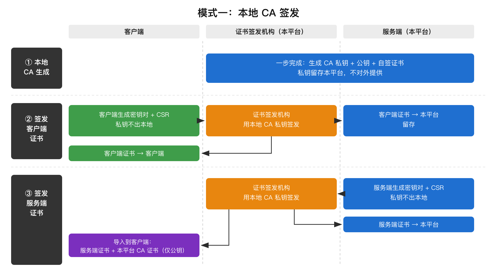
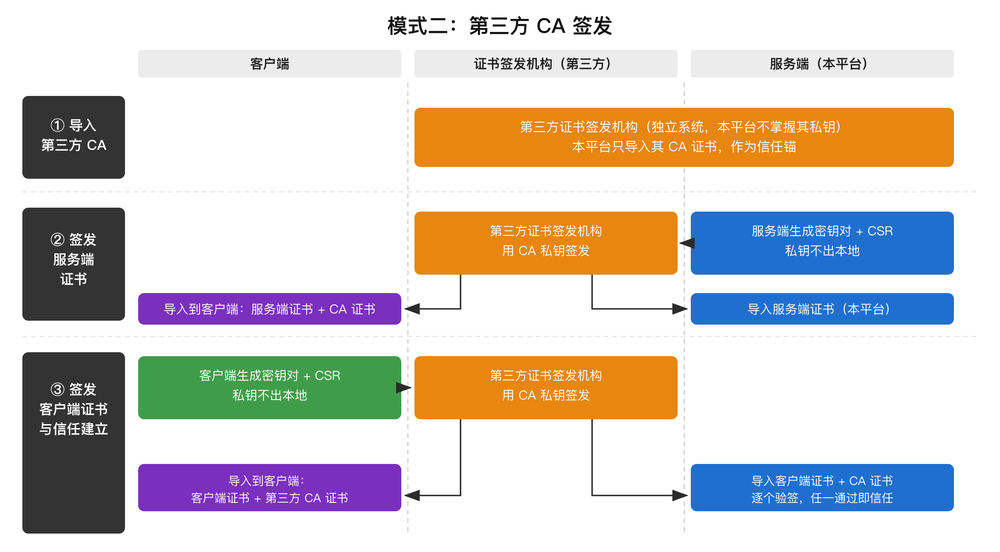
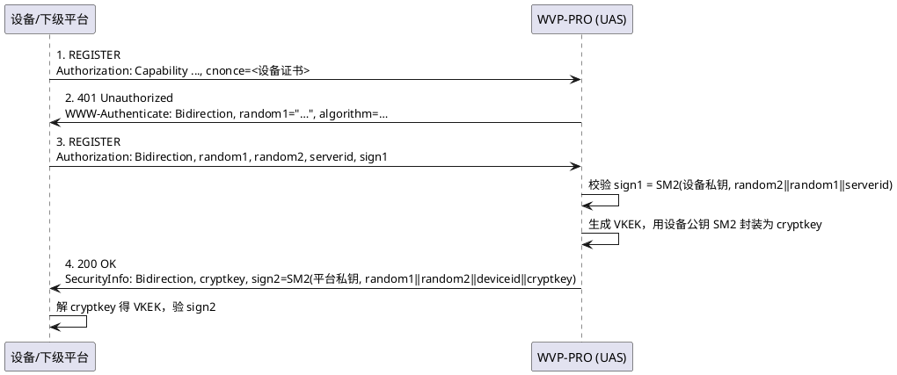
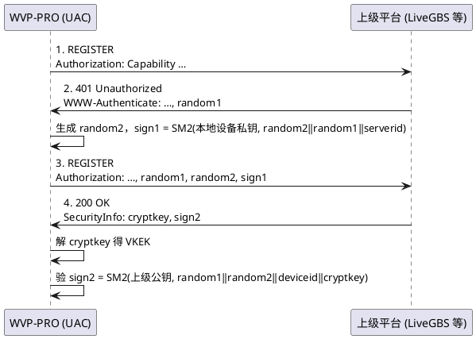

<!-- GB35114 设计说明 -->

# GB35114 设计说明

本平台在 GB28181 的基础上实现了 **GB35114 A 级**（基于数字证书的单向/双向认证）接入与级联，
包括三部分能力：

1. **证书管理** —— 本地根 CA 与受信任 CA 的管理、服务端/客户端身份的签发、导入、导出、删除、换发；
2. **证书注册认证** —— 设备侧（UAS）与平台侧（UAC）两侧的 A 级 REGISTER 握手；
3. **信令完整性认证** —— 非 REGISTER 信令的 `Note`（带密钥杂凑）加签与验签。

> 说明：本文只描述设计取舍与关键时序，逐步操作见 [使用说明](usage.md)，
> 部署与配置见 [安装说明](install.md)。

---

## 一、总体结构

### 1.1 模块划分

新增代码集中在 `com.genersoft.iot.vmp.gb35114` 包下，与既有 GB28181 代码**只通过少数几个集中点耦合**，
避免侵入式改造：

```
com.genersoft.iot.vmp.gb35114
├── conf/       Gb35114Config             YAML 配置绑定（gb35114: 段）
├── crypto/     Gb35114SmCrypto           SM2 / SM3 / VKEK 封装、随机数
│               Gb35114CertUtil           证书/CSR 生成、解析、指纹、身份加载
│               Gb35114HeaderUtil         SIP 头构造与解析（Capability/Authorization/SecurityInfo/Note）
│               Gb35114KeyProtector       私钥落地的 AES-GCM 加解密
├── cert/       bean/     Gb35114Ca、Gb35114Cert
│               dao/      Gb35114CaMapper、Gb35114CertMapper
│               service/  IGb35114CertService + impl
│               controller/ Gb35114CertController（/api/gb35114/cert/**）
└── sip/        Gb35114PlatformStateMachine   UAS 侧握手状态机（本平台作平台）
                Gb35114DeviceStateMachine     UAC 侧握手状态机（本平台作下级）
                Gb35114SecurityService        门面：状态机缓存、证书选择
                Gb35114VkekCache              VKEK 缓存（按对端国标编码）
                Gb35114NoteIntegrator         出站加签 / 入站验签的集中接入点
                Gb35114NoteService            Note 摘要的计算与校验
                Gb35114SipHeaders             jain-sip 原始头读写工具
```

与既有代码的耦合点（全部是**一处接入、全局生效**）：

| 接入点 | 位置 | 作用 |
|---|---|---|
| 出站加签 | `SIPSender.transmitRequest` | 所有出站信令统一注入 `Date` + `Note` |
| 入站验签 | `SIPProcessorObserver.processRequest` | 所有入站请求统一验 `Note`，失败回 403 |
| UAS 注册 | `RegisterRequestProcessor.registerHandler` | 识别国密 `Authorization` scheme，走国密分支 |
| UAC 注册 | `RegisterResponseProcessor` + `SIPCommanderForPlatform` | 处理 401 挑战、校验 200 的 `SecurityInfo` |
| 原始头保留 | `GBStringMsgParser` | 保留解析不了的头，供 Note 验签取回 |
| NIO 通道 | `CustomNioTcpMessageProcessor` | 修补 jain-sip 换 socket 竞态 |
| 启动串行化 | `PlatformServiceImpl` | 启动注销与定时注册串行化 |

### 1.2 为什么不改协议栈

`jain-sip` 是 GB28181 侧共用的协议栈。GB35114 的头部（`Capability`、`Bidirection`、
`SecurityInfo`、`Note`）都不是 RFC3261 标准头，标准解析器会把它们丢弃或解析失败。
因此本项目**不改协议栈的解析逻辑**，而是：

- 出站用 `Gb35114SipHeaders.addRawHeader` 直接拼头，绕过标准头的序列化；
- 入站用 `rawHeaderValue` / `unparsedHeaderValue` 从头字符串里取回。

---

## 二、证书模型

### 2.1 两个正交维度：类型 × 密钥持有方

证书按**类型**（列名 `type`，Java 侧 `Gb35114Cert.TYPE_*`）区分，而不是简单地按"服务器/设备"分。
因为"服务器证书"这个词在 UAS 和 UAC 两侧指的是完全不同的东西：

| `type` | 含义 | 私钥在哪 | 谁在用 |
|---|---|---|---|
| `SERVER_IDENTITY` | 服务端证书（本平台） | **本平台** | 本平台作 UAS，签 `sign2` |
| `DEVICE_IDENTITY` | 客户端证书（本平台） | **本平台** | 本平台作 UAC，签 `sign1`（通常由上级签发） |
| `ISSUED_DEVICE` | 客户端证书（下级设备） | 下级 | 本平台签发给下级设备/平台 |
| `TRUSTED_PLATFORM` | 服务端证书（上级平台） | 上级 | 仅公钥，验 `sign2` |

> 表里**只有这一个 `type` 列**。历史上还并存过一个整数 `type`（1-服务器 / 2-设备），
> 它是本列的派生投影且**有损** —— `SERVER_IDENTITY` 与 `TRUSTED_PLATFORM` 方向相反
> 却同落成 `1`；写入点只有 2 处、读取点 0 处。已删除，两张证书表统一用 `type` 表达
> 「这一行是什么」。

CA 按类型分两类，区分的依据是**是否持有私钥、能否签发**，而不是"服务哪个方向"：

| CA `type` | 含义 | 私钥 | 份数 | 参与什么 |
|---|---|---|---|---|
| `LOCAL_CA` | 本地根 CA | **本平台持有** | **限一份** | 签发本平台自己的证书与下级设备证书 |
| `TRUSTED_CA` | 受信任的 CA | 无（仅公钥） | 多份 | 证书链校验：上级平台证书、第三方机构签发给下级设备的证书 |

> `TRUSTED_CA` 的适用范围是**两个方向**：既验证上级平台的服务端证书，
> 也验证第三方机构签发给下级设备的客户端证书。界面上它对应「CA 证书管理 ·
> 受信任的 CA 证书」一栏，与"上级"无关 —— 一张受信任的 CA 本来就不区分它签的是谁。

### 2.1.1 归属：四个裸外键，不建表

「这张证书给谁用了」**不**由证书行自己记录，而是由引用方的外键表达：

| 引用方 | 列 | 指向 |
|---|---|---|
| `wvp_device` | `cert_id` | 该设备的国密设备证书（`ISSUED_DEVICE`） |
| `wvp_device` | `server_cert_id` | 该设备要用的国密服务端证书（`SERVER_IDENTITY`） |
| `wvp_platform` | `device_cert_id` | 本平台向该上级注册用的客户端证书（`DEVICE_IDENTITY`） |
| `wvp_platform` | `platform_cert_id` | 该上级的服务端证书（`TRUSTED_PLATFORM`） |

没有中间表、没有反向列、不加约束与级联。证书列表里的「归属」是查询时反查算出来的
（`Gb35114Cert` 的瞬态字段），因此**同一个上级的两个槽可以指向同一张证书**，
也不会出现"证书说它属于 A、A 说它没绑"的不一致。

这四个引用是**按 ID** 存的，删除证书后会立刻悬空 —— 见 §2.3 的引用守卫。

#### 后两个外键是可选的，运行期有兜底 —— 但兜底不是正路

`wvp_platform` 的两个引用列允许为 `NULL`：`uacStateMachine`
（`Gb35114SecurityService:292-303`）在为空时回退到
`queryDeviceIdentity(serverId)` / `queryTrustedPlatformCert(serverId)`，
即按国标 ID 从证书表反查（`Gb35114CertServiceImpl.resolveByType`）。

兜底让"没绑定也能跑起来"，代价是**归属没有记录**：

- 证书列表的「关联平台」列只能靠 `gb_id` 猜（`fillPlatformRelations` 的第二轮匹配）；
- 接入**第二个**上级时，`resolveByType` 面对多张候选会**拒绝猜测并返回 `null`**
  （`Gb35114CertServiceImpl:897-926`），于是注册直接失败；
- 页面上也无从回显"绑的是哪张"——绑定列是 `NULL`，而实际在用的证书另有其人。

因此编辑页把绑定做成**即时落库的独立动作**（`POST /api/gb35114/cert/bind-platform`
→ `Gb35114CertServiceImpl.bindToPlatform`），并且**显示的是"运行期实际会用到的那张"**
（显式绑定优先，否则复现后端兜底口径），而不是只看绑定列。
判据不一致时页面显示的和真正拿去签 `sign1` 的可能不是同一张 —— 那比不显示更糟。

`bindToPlatform` 只写绑定那一列，**不整行更新 platform**：绑定是证书槽自己的动作，
不该被整行保存的前置校验与唯一键（`uk_platform_unique_server_gb_id`）牵连 ——
整行保存失败时绑定跟着一起丢，而页面上看不出来。

### 2.2 签名身份的本质是密钥对，不是证书

这是整个证书体系的**核心约定**，也决定了后面所有"能并存什么、不能并存什么"的判断：

> 设备只保存平台公钥。同一密钥对签出的多张证书（有效期不同、签发者不同、序列号不同）
> 对设备**完全等价**。

因此：

- **同一个密钥对可以签出多张证书**，这是正常状态，不需要清理，也不能顺延吊销；
- 证书轮换（换有效期 / DN / 签发者而不换密钥）**不打断已配置的设备** —— 设备无需重新导入公钥；
- 但**换密钥对**等于悄悄换掉设备信任的公钥，设备验 `sign2` 必然失败，
  且平台日志上一切正常（确实签了名，只是用错了身份），故障点会漂到设备侧。

`key_fingerprint`（SM3 公钥指纹）就是为这条约定服务的：指纹相同 = 同一个签名身份。
`resolveUsableServerIdentity` 的"同组顺延"逻辑完全建立在这上面，且**绝不跨指纹组顺延**。

### 2.3 三条收敛约束

早期实现里同一逻辑身份可以被无限创建出多份互不相干的记录，导致"设备绑定的是哪一把公钥"
要靠指纹分组去猜。现在用三条约束把证书体系收敛掉：

#### 约束一：本地根 CA 只保留一份

`generateCa` / `importCa(LOCAL_CA)` 前调 `assertNoLocalCa()`，已有 `LOCAL_CA` 则拒绝。

**不做自动覆盖**：覆盖式替换会静默改变已签发证书的签发者，与"删除前先校验引用"的安全语义冲突。
轮换路径是**先删旧的、再建新的**（`deleteCa` 已有 `certMapper.countByCaId(id)` 引用守卫）。

守卫报错时**优先点名被引用的那一份**（按 `certMapper.countByCaId` 挑选），而不是最新一份 ——
否则运维会拿到一个"删了也没用"的提示。

`TRUSTED_CA` 不受限制：可以有多份 —— 多个上级各一份，第三方机构一家一份。

#### 约束二：服务端只保留一组密钥对

守卫条件统一为「**存在未吊销的 `SERVER_IDENTITY` 记录**」，加在**三个**新建入口：

| 入口 | 方法 |
|---|---|
| 一步创建（生成密钥对 + 当场签发） | `createServerIdentity` |
| 创建 CSR（随后由本平台签发或回填） | `createPendingCsr` |
| 导入证书+私钥 | `importIdentityCert` |

守卫按 `type` 门控，**只对 `SERVER_IDENTITY` 生效**：否则本平台一旦有了服务端证书，
就再也建不出下级设备的 CSR 了。

拒绝文案分两种，指向不同的出口：

- 命中**已签发**记录 → 指向「**先删除、再重新创建**」，它是唯一的换发路径；
- 命中**待签发**记录（有 CSR、无证书）→ 指向**签发**或**回填**，并给出该记录的 ID。
  待签发行不是"占用"，而是"还差一步"，让它去删掉重来会白丢一对密钥与一份 CSR。

**为什么不做"同密钥再签"**：早期版本允许对同一密钥对反复签发（原地更新，
证书 ID 不变，`wvp_device.server_cert_id` 等引用永不悬空）。这确实省事，
但它把"换证书"和"换密钥"两件事混成了一个按钮 —— 运维看到的是"延长有效期"，
而证书体系里真正需要显式确认的恰恰是密钥有没有变。取消它之后语义是单一的：
**换发 = 删除 + 重建 = 新密钥对**，设备侧必须重新导入，没有例外。

代价是必须处理**引用悬空**：删除一张仍被 `wvp_device.server_cert_id` /
`wvp_platform.platform_cert_id` 绑定的证书，会让绑定它的设备在注册时收到
`resolveServerCertId` 抛出的明确 403（**不是静默回退**）。因此 `deleteCert`
在删除前扫描引用并**拒绝**，报错点名是哪个设备/平台 —— 让问题在删除时暴露，
而不是潜伏到设备注册。

**删级联平台会连带删它绑的那两张证书**（`PlatformServiceImpl.delete`）。
绑定关系存在 `wvp_platform` 的两个裸外键上，平台行一删，证书就再没有归属，
留着只会在证书管理页堆成看不出归属的孤儿记录。三条约定：

- **顺序**：先删 platform 行，再删证书。反过来的话守卫会把本行算成"仍被引用"而拒绝，
  每张都删不掉，而删平台看起来还"成功"了 —— 一个静默的半个操作；
- **删不掉不影响删平台**：存量数据里可能两个上级指向同一张证书，先删的那个会被守卫
  拒绝。这是正确的判定，但不该把已经成功的"删平台"一起回滚，故逐张 `deleteCert`、
  异常只记日志跳过；
- **CA 永不随平台删除**：CA 是全局的（见 §2.1），不随任何级联平台删除，级联编辑页
  也只提供"导入 CA"、不提供删除。

**因此不存在"默认服务端证书"这个概念**：该类型至多一条未吊销记录，
取它即可。早期版本的 `is_default` 列（用于在"同密钥对的多张证书"之间挑锚点）
已随唯一性约束一并删除，页面上的「设为默认」入口也已去掉。

**守卫挂在"未吊销"上是为了留出应急通道**：密钥泄露 / 私钥丢失时，
把该组记录作废，守卫即失效，可以新建第二组。

> **界面只提供「删除」，没有「吊销」按钮** —— 但删除会先过引用检查（见上），
> 应急时未必删得掉。因此这条通道实际是两步：**先在设备/级联编辑页解除绑定，再删除**。
> 后端 `revokeCert` 与 `/revoke/{id}` 保留（`revoked` 列也保留，历史数据里已有该状态），
> 现场需要"不解除绑定就立刻停用"时可直接调接口 —— 少一个界面入口，换来的是不出现
> "已吊销的占位记录仍占着引用守卫"这种需要额外解释的中间态。

> 存量数据里可能留有同密钥组的多张 `SERVER_IDENTITY`（历史版本的产物）。
> `resolveUsableServerIdentity` 的**同组兄弟回退**因此保留：它只在
> `keyFingerprint` 相同的组内顺延，绝不跨组，新数据不会产生新的多张。

#### 约束二的例外：客户端证书（本平台）与服务端证书（上级平台）**不唯一**

`DEVICE_IDENTITY`（UAC 签 `sign1`）与 `TRUSTED_PLATFORM`（验 `sign2`）**不做唯一性约束** ——
本平台作为下级可以**同时接入多个上级**，每个上级各有自己的一张。

区分方式不是"标记默认"，而是**按业务对象绑定**：`wvp_platform.device_cert_id` /
`platform_cert_id`。未绑定时按上级国标编码匹配证书的 `gb_id`；匹配不到且该类型
只有一张则用它，有多张则**返回 null 并告警，绝不猜** ——
猜错等于用别的上级的身份去注册（或拿别人的公钥去验签），对方必然验不过，
而本平台日志上一切正常，故障点会漂到对端。

#### 约束三：过期默认不拒绝，只提示

`gb35114.reject-expired-cert`，默认 `false`。

**为什么做成策略而不是硬编码**：A 级握手既不校验证书链也不校验证书有效期，
设备/上级只拿公钥验签。一张刚过期几小时的证书在协议上**仍然可用**；
而按日期直接拒绝会让设备在运维还没反应过来时就被挡在门外，且现场只能翻日志才看得出原因。
默认行为是：证书列表照常标出「已过期」，由运维看到后决定删除还是重新颁发。

需要严格合规的部署再把此项置为 `true`。

> **已吊销的记录不受该开关影响** —— 命中 `revoked` 即拒绝，任何取值下都是。
> 界面上的「删除」同样绕不过：删除后指纹反查查不到记录，一样拒绝。

### 2.4 私钥的存储与保护

| 项 | 做法 |
|---|---|
| 落地加密 | `Gb35114KeyProtector`，AES-GCM，密钥来自 `gb35114.key-encrypt-password` |
| 存储位置 | 与 CSR / 证书**同一条记录**的 `key_pem` 列 |
| 删除语义 | 删除该记录即删除私钥，不留副本 |
| 下发限制 | `keyPem` 标 `@JsonIgnore`，**永不出现在任何 API 响应中**；列表只返回 `hasKey` 布尔值 |
| 导出 | 仅"导出证书"（`cert_pem` 公钥部分）与"导出 CSR"，私钥不提供导出接口 |

### 2.5 设备证书主题 CN 的格式（附录 A / 附录 B）

GB 35114—2017 **附录 A 是规范性附录**，A.2「设备证书格式」表 A.1 第 6 项
「证书持有者信息」规定设备标识（CN，字符型 128 字节）：

> 格式为：**设备 ID、密码模块 ID**，ID 间以「`_`」分隔，某个 ID 为空时值为「**NULL**」。

密码模块 ID 的编码规则见**附录 B**：22 位十进制，五码段
= 产品型号编码 4（国家密码管理局批准型号的后四位）+ 类型编码 2（`01` 安全芯片 /
`02` 安全 TF 卡 / `99` 其他）+ 生产日期编码 8（`YYYYMMDD`）+ 批次编码 3 + 序号 5。

**范围**：附录 A 只约束**设备证书**。本平台自身证书（服务端 / 根 CA）的主题格式
**不受该规定约束**，只是**沿用**同一个形状 —— 三者都是本平台自己签发的证书身份，
用同一套命名比各立一套更好理解。既然是沿用而非强制，就不对它设卡：
想给服务端证书起个别的名字也应当允许。

**落地口径**：

| 项 | 做法 |
|---|---|
| 主题默认值 | 所有证书（服务端 / 客户端 / 根 CA）的主题都默认 `本平台国标ID_密码模块ID`（`defaultSubjectCn`），表单只留一个可改的「主题（CN）」字段 |
| 为什么不拆字段 | 国标 ID 与密码模块 ID 只是默认主题的组成成分。拆成独立输入框等于把同一个值让用户填三遍，且改一处还要同步另两处；而实际上唯一需要用户判断的就是「主题该叫什么」 |
| 国标 ID 段 | 取自 `sip.id`。接入上级时未必适用（可能另编一个以防冲突），因此**主题整体可改** |
| 密码模块 ID 段 | 取自配置 `gb35114.module-id`（`Gb35114Config#resolvedModuleId`），留空即 22 个 `0`（`Gb35114CertUtil.MODULE_ID_PLACEHOLDER`）。**做成配置项而非写死**：本平台无硬件密码模块时占位用全 0，但现场若有已备案的密码模块编号，这个值由运维/检测机构决定，检测时要能拿出「主题里的模块 ID 与备案一致」这个事实 |
| 配置写错怎么办 | **原样下发，不静默改写成全 0**。改写会让「配置写错了」这件事在页面上看不出来，运维改了个错值、页面显示却合规。页面（`checkSubjectModuleId`）与后端（`requireValidDeviceCn`）各自提示/拒绝 |
| 落库 | `module_id` 列一律由 `subject_cn` 反解析（`Gb35114CertUtil.parseDeviceIds`），不单独采信表单字段 —— 保证「列 ↔ 证书」一致 |
| 后端兜底 | 主题留空时 `applyDefaultSubjectCn` 补默认值（不依赖前端）；`requireValidDeviceCn` 在创建时校验设备证书的模块 ID 段非空且非 `NULL` 时必须是 22 位十进制。**只校验 `DEVICE_IDENTITY`** —— 那是附录 A 的强制要求；对本平台自身证书设卡会把一个命名约定变成硬性要求 |

**级联页的 CSR 入口**：国标级联编辑页的「创建 CSR」打开的是与「国密证书管理」页
**同一个形状**的对话框（主题 CN + C/ST/L/O/OU + 有效期 + 备注）—— 同一件事两个入口，
长得不一样只会让人以为做的事不一样。默认主题取「**本平台在该上级处的国标 ID**\_密码模块 ID」，
国标 ID 优先取 SIP 认证用户名（`username`，页面上由「设备国标编号」自动带出），
退回 `deviceGBId` → `serverGBId`。与旧实现（直接拿 `deviceGBId` 当主题、其余 DN 字段全丢）
相比，两个不一致都消掉了：CN 补上了 `_密码模块ID` 段，C/ST/L/O/OU/备注 也不再丢失。

**为什么模块 ID 要单列一列**：GB/T 43026—2023 表 4 序号 1「设备身份管理」要求受测平台
对「设备 ID、其密码模块 ID 与设备证书的对应关系」作管理，判定项 a) 是
"平台中查看上述对应关系与真实信息符合"。三者中设备 ID 与证书各已有列，
单列出密码模块 ID 才凑齐这一组可核查的关系。

**页面列的精简**：既然主题已经是 `国标ID_密码模块ID`，「本平台编码」列与主题列
说的是同一件事，留着只是重复 —— 已从「服务端证书（本平台）」与「客户端证书（本平台）」
两个 tab 删除。「下级客户端编码」/「上级平台编码」保留：那两个 `gb_id` 指的是**对端**
对象，与主题里的本平台编码不是一回事，删了就无从判断证书是给谁的。

**尚未对齐的部分（已知差异）**：表 A.1 还规定网络类型（O）取值 `01` 公安信息网 /
`02` 视频专网、预留（O）`00`、S/L 按 GB/T 2260—2007 取行政区划代码、
C 按 GB/T 2659—2000。本平台目前 O 段放的是组织名、无预留段、S/L 用拼音。
改动会直接影响与设备厂商的互通，且需要 GB/T 2260 / 2659 代码表，
**暂不改动**，仅在此记录。

---

### 2.6 两种签发模式：本地 CA 与第三方 CA

前面几节讲的是**本平台内部**怎么组织证书。这一节换一个角度：证书**从哪来**。
现场部署只有两种形态，它们的信任建立方式完全不同，**不能混着用**。

| | 模式一：本地 CA 签发 | 模式二：第三方 CA 签发 |
|---|---|---|
| CA 私钥在哪 | **本平台** | 第三方机构（本平台不掌握） |
| 证书由谁签 | 本平台自己签 | 第三方机构签 |
| 身份判据 | 查本平台签发记录 | 用导入的 CA 证书验签 |
| 典型场景 | 单点部署、无既有 PKI | 公安信息网等已有统一证书管理系统 |

> 这里的"客户端 / 服务端"是 **GB 35114 握手里的角色**，不是"浏览器 / Web 服务器"：
> 发起注册的一方是客户端（UAC），接受注册的一方是服务端（UAS）。
> 本平台在下级设备面前是服务端，在上级平台面前是客户端。

#### 模式一：本地 CA 签发



本平台自己生成根 CA（私钥 + 公钥 + 自签证书），私钥**始终留在本平台**，
此后所有证书都由这把私钥签发。

1. **生成本地 CA** —— 填一系列信息，生成 CA 私钥、公钥与自签证书。私钥加密落库，
   不出平台（见 §2.4）。
2. **客户端证书（下级设备 / 上级平台）** —— 对端自己生成密钥对，**私钥不出本地**，
   只把 CSR（内含公钥）交上来；本平台用本地 CA 私钥签发。对应类型 `ISSUED_DEVICE`。
3. **服务端证书（本平台）** —— 本平台生成密钥对，用本地 CA 私钥签发。对应类型
   `SERVER_IDENTITY`。这一步有**三条路**，产出的都是同一件事，按现场条件选：
   「创建服务端证书」（密钥对与签发一次完成）、「创建 CSR」后再由本平台签发
   （需要留存 CSR、或签发动作要另行审批时用它；`caId` 传空即自签）、
   以及「导入（证书+私钥）」（证书已由外部机构签好时用它）。
4. **导入到客户端** —— 把**客户端自己的证书**、**本平台 CA 证书（只有公钥）**、
   **服务端证书**三样交给对端。
5. **验证** —— 见下方"两种模式下验证强度的差异"。

> **服务端证书允许自签。** 上面第 3 步画的是"用本地 CA 签发"这条常规路径，
> 但**本平台作 UAS（接入下级设备/平台）时用的服务端证书，允许自签名**
> （`createServerIdentity` 与 `signPendingServerIdentity` 的 `caId` 传空即自签，
> 见 §2.3 约束二）。
>
> 之所以允许，是因为这张证书的作用只是把本平台的公钥交给对端 —— 对端验的是
> **公钥**，不是"谁签的"。自签只是把"签发者"这一栏填成自己，不改变对端拿到的
> 公钥，因此不影响任何一方的验签结果。
>
> 代价是**运维上的**：自签时对端必须直接导入这张服务端证书；用本地 CA 签发时，
> 对端只需导入一次 CA 证书，此后本平台换发服务端证书（只要不换密钥对）都不必
> 重新配置设备。所以自签适合联调、单点部署或没有本地 CA 的场景，
> **正式多设备部署建议用本地 CA 签发**。

#### 模式二：第三方 CA 签发



现场已有一套独立的证书管理系统（例如公安系统内部），**不依赖本平台生成证书**。
本平台只导入它的 CA 证书作为**信任锚**。

1. **CA** —— 只需导入第三方 CA 证书（`TRUSTED_CA`，界面「CA 证书管理 · 受信任的 CA 证书」）。
   私钥在对方手里，本平台拿不到，也不需要。
2. **客户端证书（下级设备）** —— 客户端生成 CSR 向第三方 CA 申请，**这一段与本平台无关**；
   签好的证书导入客户端。平台侧则导入第三方 CA + 该客户端证书，注册时靠**链校验**确认其有效。
3. **服务端证书（本平台）** —— 本平台生成密钥对与 CSR（「创建 CSR」），向第三方 CA
   申请签发，再把签好的证书**回填**到同一条记录（「回填」）。这张证书是**本平台自己
   申请来的，无需自验**。若第三方把证书与私钥一起交付，也可改用「导入（证书+私钥）」。
4. **导入到客户端** —— 客户端侧：客户端证书 + 服务端 CA 证书 + 服务端证书；
   服务端侧：自己申请的服务端证书 + 验客户端所需的 CA + 客户端证书。

> 模式二里「服务端证书」与「客户端证书（下级设备）」的**信任判据都是链校验**，
> 而两者的候选 CA 集合是同一个（本地 CA + 受信任的 CA）。这不是巧合：
> 一张 CA 证书本来就不区分它签的是服务端还是客户端。

#### 两种模式下验证强度的差异

这是两种模式**最本质的区别**，也是最容易搞混的地方：

| 验证方向 | 模式一（本地 CA） | 模式二（第三方 CA） |
|---|---|---|
| 服务端验客户端证书 | 证书是本平台自己签的，**验证必然通过**，只有有效期值得看一眼 | **必须验签** —— 证书不是自己签的，验签是唯一判据 |
| 客户端验服务端证书 | 用本平台 CA 证书验签，**必须通过** | 用第三方 CA 证书验签，**必须通过** |

**模式一下"服务端不必验证自己签的证书"不等于"跳过验证"**：流程照走，结论恒定。
把这段跳过在功能上等价，但会让两种模式在代码里分叉 —— 而分叉出来的那条路径
永远不会被模式二走到，等于给一个真实存在的分支留下无人覆盖的死角。因此**不跳过**。

**模式二下验签是承重的**：一旦验不过，就说明对端出示的证书不是那个 CA 签的，
没有别的依据可以回退。这与模式一形成对照 —— 模式一里"证书是谁签的"由**记录**回答，
验签只是纵深防御。

> **自签服务端证书的位置**：上表"客户端验服务端证书"一栏默认本平台的服务端证书
> 是由 CA 签的。若本平台的服务端证书是**自签**的（见模式一第 3 步的说明），
> 那么客户端侧就不是"用 CA 证书验签"，而是**直接导入这张服务端证书本身**来验 ——
> 判据从"由某个 CA 签发"变成"就是这一张证书"。对端拿到的公钥不变，验签结果也不变，
> 变的只是对端需要预先持有哪一份文件。

#### 多 CA 并存

模式二天然会有**多个 CA**，这不是例外而是常态：

- **按类型分设** —— GB 35114 §5.2 定义了 4 类证书，实际 PKI 常按类型分设签发 CA；
- **厂商 / 区域并存** —— N 家设备的证书可能出自 N 个签发 CA；
- **轮换** —— CA 自己会过期、会更换，过渡期新旧必须并存，否则老设备全部掉线；
- **层级** —— 若 PKI 是「根 → 中间 → 设备证书」，由于**协议线上传不了证书链**
  （GB 35114 握手报文里没有承载中间证书的字段），凡直接签发被接受证书的那一级
  都必须单独导入，导入根没有用。

因此模式二的判定是**并集**：导入 N 个信任锚，收到证书后**逐个验签，任一通过即信任**。

> **一个要分清的边界**：多 CA 对**验签**是正常且必要的（信任锚集合），
> 对**签发**则是危险的歧义源（"该用哪把私钥签"）。现有设计正是按这条边界分的 ——
> `LOCAL_CA` 限一份（管签发），`TRUSTED_CA` 允许多份（管验签）。

#### 现状与差距

以上是两种模式**完整**的形态。当前实现以模式一为主，模式二**支持了签发与信任锚，
但吊销与有效期仍按模式一的方式处理**，差距如下（如实记录，未实现的部分不要当成已支持）：

| 项 | 现状 |
|---|---|
| 服务端证书（本平台）走第三方签发 | **已支持**。三条路并存：一步生成（`createServerIdentity`）、CSR → 本平台签发/自签（`createPendingCsr` + `signPendingServerIdentity`）、回填外部签发（`importIdentityCert` 或 `createPendingCsr` + `completePendingWithCert`） |
| 客户端证书（本平台）走第三方签发 | **已支持**。CSR 导出 / 回填路径；签发回来的证书按本平台记录留存，回填时校验公私钥配对 |
| 设备证书的信任锚 | **已支持**。`validateAnnouncedDeviceCert` 仍要求指纹命中本平台记录（防"无记录的证书"），但**链校验的候选集已含 `TRUSTED_CA`** —— 第三方机构签发的设备证书导入后即可通过 |
| `TRUSTED_CA` 的适用范围 | **两个方向**：上级平台证书 + 第三方签发给下级设备的证书（见 §2.1） |
| 吊销 | 模式二下应依赖 **CRL/OCSP**（GB 35114 §5.3 要求支持 GM/T 0015—2012，附录 A 表 A.1 含「CRL 分布点」），**未实现**；仍靠本平台记录里的 `revoked` 位（界面不提供吊销入口，见 §2.3 约束二） |
| 有效期 | 模式二下有效期是承重判据，`gb35114.reject-expired-cert` 默认关，未按第三方签发周期调整 |

> 设备证书这一项的改动**只在候选集与报错信息**：`validateDeviceCertChain`
> 从不读 `ca.getPurpose()`，它只调 `chainFailureReason`（验签 + CA 资格判定）。
> 因此"接受受信任 CA 签发的设备证书"**不需要改判定逻辑**，只需要把候选集从
> "本地 CA" 扩到 "本地 CA + 受信任的 CA"。这一点由测试锁定，不靠推理。

> 若要把模式二做**完整**，剩下的改动面集中在吊销与有效期：吊销要从"本地位"
> 换成"CRL 拉取"，有效期要从"可宽松"换成"必须严格执行"。**这两件事与链校验耦合，
> 不能只做一件** —— 只开链校验而不做 CRL，等于把信任判据放宽了却没有收紧失效判据。

> **`gb35114.skip-cert-chain-verify` 不能用来实现模式二**（见 §3.4）。它只关掉
> 「证书由哪张 CA 签发」这一条，而模式二要求的是把身份判据**换成**链校验通过 ——
> 上表前三行的拦截都发生在链校验**之前**（指纹必须命中本平台签发记录），
> 因此打开本开关后第三方签发的设备证书**仍会被拒**。它是"拿不到 CA 时的逃生口"，
> 不是"接入第三方 CA 的开关"。

---

## 三、A 级注册握手

### 3.1 UAS 侧（本平台作平台，接受下级设备/平台注册）



关键实现点（`Gb35114PlatformStateMachine`）：

- **会话按设备 ID 索引**，`Session` 内 `synchronized`，保证并发重注册安全；
- **幂等重传**：SIP-over-UDP 会重传已完成握手的 REGISTER，
  `verifyRegister` 比对 `lastAuth`，命中则直接返回上次的 `lastSecurityInfo`，不重新协商 VKEK；
- **算法协商**：401 挑战里的 `algorithm` 必须是**从设备上报能力中选出的结果**（标准 §C.3 b)），
  只回内置的 `A:SM2;H:SM3` 会让协商结果与设备预期不符；`200 OK` 的 `SecurityInfo` 里也必须回同一个串；
- **`serverid` 取 `sip.id`**（平台国标编码），不是 `userSetting.serverId`（那是集群内节点标识，默认 `000000`）。
  设备签名 `sign1` 时用的就是 `sip.id`，两者必须一致，否则报 `server id mismatch`；
- **设备证书的最后一道校验**：设备会在 `Capability` 的 `cnonce` 里**自报证书**，这条路径不过数据库。
  因此 `certValidator` 必须对**所有来源**（预置 / 自报 / 数据库）的证书做吊销与过期校验 ——
  否则一台已被停用的摄像头只要自报旧证书就能绕过列表查询的过滤重新接入，停用形同虚设。
  （停用现在由「删除」完成，自报路径查不到记录即拒绝；`revoked` 位的校验同样保留，
  以覆盖历史数据与直接调 `/revoke/{id}` 的情形。）

### 3.2 UAC 侧（本平台作下级，向上级平台注册）



关键实现点（`Gb35114DeviceStateMachine`）：

- **`serverid` 允许缺失**：部分平台（如 LiveGBS）在 200 OK 里不回它。它不携带新信息 ——
  本次 REGISTER 的目的地已唯一确定平台编码，缺省即"就是它"；对端回了则必须一致。
- **状态机按 `serverId|deviceCertId|platformCertId` 复合键缓存**，证书配置变化时重建，
  避免复用旧证书签出的握手状态。

### 3.3 平台侧证书的选择顺序

`Gb35114SecurityService.resolveServerCertId` 决定 UAS 侧用哪张证书签 `sign2`，
优先级为：

1. **设备级绑定** `wvp_device.server_cert_id` —— 运维对该设备的明确承诺；
2. **证书表中唯一的那张 `SERVER_IDENTITY`** —— 该类型由后端强制唯一（见 §2.2），
   因此不存在"选哪张"的歧义，也无需 `is_default` 标记。

**两条路径共用同一条规则**：在"指定的那张证书所属的**密钥组**"内解析可用证书。
指定的证书过期时，只要同组还有可用证书就继续用，设备无需重新配置；同组全过期才拒绝。

这条规则不参与顺延的只有**吊销**（见 §2.2）。顺延**绝不跨密钥组** ——
理由见 §2.2 最后一段。

> 注：平台可以并存多张服务端证书，但**同一时刻只有一个有效的密钥对**
> （约束二保证）。多张证书只是同一个密钥对的不同"外衣"，
> 供不同客户端使用不同的有效期/DN 而已。

### 3.4 证书链校验：设备侧恒开、级联侧可选

> 本节讲的是**链校验在本平台内部怎么开关**。链校验在两种签发模式下扮演的角色
> 完全不同（模式一里是纵深防御，模式二里是唯一判据），见 [§2.6](#26-两种签发模式本地-ca-与第三方-ca)。

**标准只对设备身份认证要求链校验。** GB/T 43026—2023 附录 B 表 B.1 里
「需验证证书链是否正确」只出现在序号 3、6、7（7.2、7.4），序号 8、9（7.5 上联/下联，
即平台间认证）的备注列是空的。因此两个方向处理不同：

| 方向 | 本平台角色 | 是否校验 | 说明 |
|---|---|---|---|
| 设备接入 | 上级（UAS） | **恒开** | 7.4 是必测项 |
| 级联上级 | 下级（UAC） | 由 `gb35114.verify-upstream-cert-chain` 控制，默认开 | 7.5 无此要求，但默认从严；需要放宽就显式置 false |

**两个方向都受一个全局逃生口约束**：`gb35114.skip-cert-chain-verify`（默认 `false`）。
见下方「拿不到 CA 时的逃生口」。

**设备侧为什么要在指纹校验之外再加链校验**：两者回答不同问题。指纹反查回答
「本平台是否给这把公钥签发过证书」，链校验回答「这张证书是否由本平台 CA 签发」。
只看指纹会漏掉一个真实漏洞 —— 设备拿自己的私钥自签一张证书，只要公钥与库里那张相同，
指纹就命中、记录也有效，于是被放行。链校验补上了这一步。

**级联侧为什么默认开**：标准对平台间认证（7.5）没有链校验**要求**，但"没有要求"
不等于"应当关掉" —— 关掉它意味着任意一张证书都能冒充上级。默认从严、需要时显式放宽，
更符合检测现场的口径。放宽有两条路，优先用前一条：

| 情形 | 用什么 | 影响面 |
|---|---|---|
| 只有上级方向拿不到 CA | `verify-upstream-cert-chain: false` | 只关上级方向，设备方向照旧恒开 |
| 两个方向都拿不到 CA | `skip-cert-chain-verify: true` | 全局 |

且实际部署里 `TRUSTED_CA` 与 `TRUSTED_PLATFORM` 常常是同一张自签证书 —— 这不成问题：
自签证书走的是「受信任的 CA 列表里存在与它同公钥的一条」这条判据，把该证书本身
再导入一份「受信任的 CA」即可通过，不必真去要一张独立 CA。

#### 拿不到 CA 时的逃生口（`skip-cert-chain-verify`）

现场存在一种**无解**的情况：CA 根本拿不到。上级只发一张证书、不给签发它的 CA；
设备证书由厂商工具签发，CA 不外流；或 CA 已停用/丢失，无法补齐。此时链校验会让
设备或级联平台**全部无法接入**，而本平台没有任何办法自行补出那张 CA。

`gb35114.skip-cert-chain-verify`（默认 `false`，即验证）就是为这种情况准备的全局开关。
置为 `true` 时：

| 跳过 | 不跳过 |
|---|---|
| 设备证书是否由已导入的 CA 签发 | **指纹反查** —— 仍要求命中本平台 `ISSUED_DEVICE` 记录 |
| 上级证书是否由受信任的 CA 签发 | **吊销**判定 |
| 「本平台一张 CA 都没有」这条拦截 | **有效期**判定（是否拒绝另由 `reject-expired-cert` 控制） |
| | 握手本身的 SM2 验签（`sign1`/`sign2`） |

**最后一行最容易误解**：本开关关的是「**证书链**」，不是「**签名**」。握手时对端用私钥
签 `sign1`/`sign2`、本平台用对端证书里的公钥验签，这一步是**协议层的身份认证**，
与「这张证书是谁签发的」是两件事，开关**不影响**它。因此打开后仍然无法冒充对端 ——
冒充需要对方的私钥。

**打开后的信任依据**退化为：设备方向 = 「本平台签发记录存在」，上级方向 = 「对端自报的
证书可直接使用」。这是**可用性优先**的取舍，会降低对「证书被替换」的防护
（例如设备用同一密钥自签一张证书，指纹反查仍会放行）。**仅在确实拿不到 CA 时使用**，
并应记录在案。

#### 验签前的 DN 快速映射

链校验要判断「这张证书是否由某张 CA 签发」，判定手段是 `leaf.verify(caPublicKey)` ——
一次 SM2 验签。CA 多的时候逐个试是浪费，因此在验签**之前**先按 DN 缩小候选。

依据是 X.509 的固有语义，不是启发式：**证书的 `issuer` 字段必然等于签发它的那张 CA 的
`subject`**。本平台的签发路径正是用 CA 证书的 subject 作 issuer，外部 CA 签出的证书同样
满足这一条。所以「issuer DN 对不上」的 CA **不可能**是签发者，可以安全排除。

DN 比对用 `X500Principal.equals`（规范化比较），而非字符串 —— 同一 DN 的字符串写法可能
因属性顺序、转义、大小写而不同。这也顺带绕开了「不同 CA 共用 CN」的问题：
比对的是**完整 DN**，而 `resolveIssuerCaId` 当初拒绝按 CN 匹配，正是因为 CN 会重名。

**命中为空时必须退回原候选集**，这是安全底线。三种情况会导致命中为空：
存量 CA 记录的 `subject_dn` 尚未回填（该列是后加的）、DN 写法差异超出规范化范围、
以及候选集本身就是空的。因此实现里对 `subject_dn` 为空的记录一律**保留**在候选里，
且缩小结果为空时直接用原候选集。**缩小只允许排除「确定不可能」的，不允许误伤** ——
否则同一把密钥的证书会被误拒，而这与「它是否真的由该 CA 签发」毫无关系。

> 这条优化是纯性能改动，不改变任何判定结果：缩小后的候选集若通过验签则通过，
> 全不通过则仍拒绝，与缩小前一致。

`TRUSTED_CA` 因此有**三层**作用：

1. **参与信任判定** —— 证书链校验的候选集是「本地 CA + 受信任的 CA」，
   **两个方向共用同一个集合**：上级平台证书（`verify-upstream-cert-chain` 默认开）
   与第三方签发给下级设备的证书（恒开）。这两件事今天已经是同一段代码。
2. **标识**服务端证书（上级平台）的签发者（见 §6.2、§6.3），让页面能显示
   "这张证书由哪个受信任的 CA 签发、服务于哪个级联平台"。
3. **反查关联证书** —— 页面上每张 CA 显示它签发了多少张证书，点开可看清单
   （见 §6.3）。删除被引用的 CA 会被拒绝，报错点名是哪些证书。

> 关联（`ca_id`）与校验是两回事：`ca_id` 由「用候选 CA 公钥验签」得出，表达**谱系**事实，
> 不要求候选具备 CA 资格；信任判定才要求「签发者确实是 CA」。自签证书同样参与关联 ——
> 它的签名只能被同公钥的证书验过，因此能关联到「同一张证书已作为 CA 导入」的那条记录。

---

## 四、信令完整性认证（Note）

### 4.1 为什么需要它

REGISTER 握手只解决了**注册这一刻**的身份认证。注册成功后的 Catalog 查询、INVITE 点播等信令，
如果不做完整性保护，任何人都能伪造。GB35114 用 `Note` 头承载
「对端用协商出的 VKEK 做的带密钥杂凑」，覆盖方法、From、To、CallId、Date 与消息体。

### 4.2 两个集中点

| 方向 | 接入点 | 行为 |
|---|---|---|
| 出站 | `SIPSender.transmitRequest` → `Gb35114NoteIntegrator.decorateOutgoing` | 非 REGISTER 且已协商 VKEK → 注入 `Date` + `Note` |
| 入站 | `SIPProcessorObserver.processRequest` → `verifyIncoming` | 带 `Note` 的非 REGISTER 请求验签，失败回 **403** 并丢弃 |

**入站策略**：无 `Note` 的请求**放行**（兼容混跑 Digest 的平台）；
`Note` 存在但验签失败则拒绝。这样不会因为对端不支持而把原有 Digest 设备挡在门外。

### 4.3 两个必须处理的坑

**坑一：`To` 头指向的是通道，不是设备。**

点播类信令的 `To` 是 `<sip:34020000001320000001@…>`（通道编码），
而 VKEK 是注册时按**设备编码** `35020000001320000001` 协商并缓存的，直接查必然落空。

若静默返回，请求就会以"无 Note"的形式发出 —— 设备按 A 级要求校验完整性，一律回 403，
表现为**"注册成功、目录能拿到，但一点播就 Forbidden"**。

处理：按通道反查其所属设备（`deviceIdOfChannel` → `IDeviceService`），用设备的 VKEK 加签。

> `IDeviceService` 用 `ObjectProvider` **延迟获取**而非直接 `@Autowired`：
> `IDeviceService → ISIPCommander → SipLayer → SIPProcessorObserver → Gb35114NoteIntegrator`
> 直接注入会形成 Bean 循环依赖，导致应用启动失败。

**坑二：ISO8601 的 `Date` 会被标准解析器丢弃。**

`Gb35114HeaderUtil.buildDate` 产出的是 ISO8601（如 `2026-09-17T20:27:26.000`），
而 jain-sip 的标准 `DateParser` 要求 RFC1123（带星期几），必然解析失败。

更麻烦的是失败之后的去向：`GBStringMsgParser` 在无 listener 时**直接吞掉异常**，
这个头就此从消息里消失 —— 既不在标准头里，也不在 `unrecognizedHeaders` 里，事后完全取不回来。
而这条路径并非理论情况：本项目用 NIO TCP，jain-sip 的 `NioPipelineParser` 给
`parseSIPMessage` 传的 listener 就是 `null`（阻塞式 `PipelinedMsgParser` 才传通道自身）。

结果就是 Note 验签拿不到 `Date`，摘要无法复算，设备的所有非 REGISTER 请求全被丢弃。

处理：`GBStringMsgParser` 在无 listener 分支加 `message.addUnparsed(header)` 保留原始头文本，
入站侧用 `Gb35114SipHeaders.unparsedHeaderValue` 取回。

### 4.4 VKEK 的文本形式可配

标准只写「密钥」，未规定它在摘要里的文本形式，各厂商实现不一。
因此 `gb35114.note.vkek-form` 提供 `raw`（16 字节原文）/ `base64` / `hex` 三选一，
现场联调时可逐项开关/切换做二分定位，不必改代码重新发版。

`gb35114.note.enabled=false` 则既不加签也不验签，用于判定"对端 4xx 是否由 Note 引起"。

### 4.5 VKEK 更新周期：注册周期必须 ≤ 1 天

**规范要求是硬的**，不是工程建议：

> GB 35114—2017 **6.14.3** 视频密钥加密密钥 VKEK 更新周期不大于 1 天。
>
> GB/T 43026—2023 **7.13** 对称密钥管理测试 · 表 13 序号 1「视频密钥加密密钥 VKEK
> 更新和存储管理」：受测设备/受测平台注册时更新 VKEK 且 **VKEK 更新周期不大于 1 d**。
> 判定准则 a) 为「身份注册认证时间间隔符合 GB 35114—2017 中 6.14 的规定」，
> 测试方法是「查看受测设备与测试平台间**身份注册认证时间间隔的配置**」。

注意测试方法查的是**配置值**本身，不看运行时是否真的刷新过 —— 所以这一项无法靠
"跑起来没问题"蒙混过去。

**为什么"注册周期"就是"VKEK 更新周期"**：本实现的 VKEK 只在注册握手时生成
（`Gb35114PlatformStateMachine#verifyRegister`），此后不随控制信令轮换，也没有独立的
定时更新任务。因此让注册周期 ≤ 1 天，是当前实现满足 6.14.3 的唯一手段。
（标准另有 C.6.6.4 h) 的「VKEK 通知」机制 —— 点播中 VKEK 变更时用 `Message` 通知
接收者 —— 本实现**尚未做**，属已知缺口，见本节末。）

**两个方向分别卡**，收在 `Gb35114VkekPeriod` 一处：

| 方向 | 落点 | 做法 |
|---|---|---|
| UAS（设备注册到本平台） | `RegisterRequestProcessor#gb35114RegisterHandler` | 设备请求的 `Expires` 超限时，200 OK 里回**钳到上限**的值；设备据此提前重注册，VKEK 随之刷新 |
| UAC（本平台注册到上级） | `PlatformController#clampVkekPeriod`（`add`/`update` 共用） | 保存上级时把 `wvp_platform.expires` 钳到上限内，本平台发出的 `Expires` 自然合规 |

几处刻意的取舍：

- **只钳国密那一路**。普通 Digest 注册/级联没有 VKEK，与 6.14.3 无关，钳它会平白改变
  既有行为。故 UAS 侧只在 GB35114 分支钳，UAC 侧只对 `registerWay` 为 3/4 的上级钳。
- **钳制而非拒绝**。超限的存量配置、或对端设备请求了超长周期，压到合规值即可继续工作；
  拒绝会让原本能跑的接入直接断掉。发生钳制时记 warn，把"谁在超限"变成运维可见的事实。
- **`0` 原样穿过**。注册语义里 `Expires: 0` 表示**注销**，不是"周期为 0"。若被钳成正数，
  注销请求会变成一次注册，设备下线不掉。
- **落库存实际生效值**。`wvp_device.expires` 存钳制后的值 —— 设备会按 200 OK 里的周期
  重注册，而该列参与离线判定（`DeviceServiceImpl` 取它与心跳窗口的较小者）。存大了会让
  设备早已重注册、界面却仍显示在线。
- **卡在 Controller 而不是前端**。前端可以被绕过，而这是协议硬指标。

**已知缺口：VKEK 通知信令未实现。** GB 35114—2017 C.6.6.4 h)（及 43026 表 13 之后的
「VKEK 通知（上联/下联）」测试项）要求：实时点播过程中 VKEK 改变时，SIP 服务器通过
会话内 `Message` 消息把新的 VKEK 密文与版本号通知媒体流接收者，**点播不中断**。
本实现既不做主动的 VKEK 轮换，也不处理这类 `Message`。它不影响本次的 6.14.3 合规
（注册周期已钳到 1 天内），但若要过 43026 的「VKEK 通知」测试项，需要另做一块功能。

---

## 五、两个非国密特有的修复

这两处不是 GB35114 协议要求，而是在国密场景下被**放大暴露**出来的既有缺陷 ——
A 级握手有 4 个来回（而 Digest 只有 2 个），每次都伴随换 socket，把竞态窗口从"偶尔"
变成了"每次必现"。修复本身对普通 GB28181 也是净收益。

### 5.1 jain-sip NIO 换 socket 竞态

**症状**：注册时好时坏（实测 7 次换 socket 丢 1 次），应用层毫无感知 ——
`SipProviderImpl` 照样打 `done sending ... to hop`，WVP 只能等 2000ms 后报
`注册失败: 消息超时未回复`。

**根因**：对端在每次 REGISTER 应答后就关连接，于是每次重发 REGISTER 都会走到
"换 socket"这条路。`NioTcpMessageChannel.sendTCPMessage` 的时序是：

1. `NIOHandler.sendBytes` → `openOutgoingConnection` → `blockingConnect`：
   新建 socket、连上、`configureBlocking(false)`，入队 `ChangeRequest(socket, REGISTER, OP_READ)`
   并 **`selector.wakeup()`**；
2. 回到 `sendBytes` → `writeChunks` → `send(SocketChannel, byte[])`：入队 `PendingData` +
   `ChangeRequest(socket, CHANGEOPS, OP_WRITE)` 并**再次 `wakeup()`**；
3. **直到这时** `sendTCPMessage` 才做 `close(false,false)`（关旧 socket，是个系统调用）
   + 替换 `this.socketChannel` + `nioHandler.putMessageChannel(新socket, this)`。

第 1、2 步已经把 selector 线程叫醒了，而第 3 步给新 socket 建立映射还在后面。
selector 线程只要先跑到 `ProcessorTask.write(key)`，`getMessageChannel(新socket)` 就返回 `null`，
于是打 `Need to write something on nioTcpMessageChannel null` → `Dead socketChannel`，
执行 `key.cancel()` 与 `pendingData.remove(socket)`：**这批字节被静默丢弃，一个字节都没上线**。

胜负由「应用线程关旧 socket 的耗时」与「selector 线程被唤醒的时机」决定。

**修补**：覆写 `CustomNioTcpMessageProcessor.send(SocketChannel, byte[])`，
在把 socket 交给 selector 线程**之前**先把 `channelMap` 补上。

正确性保证：本方法里先 `putMessageChannel`，随后 `super.send` 才 `changeRequests.add(...)`，
而 `changeRequests` 是 `ConcurrentLinkedQueue` —— selector 线程 `poll()` 到这条
`ChangeRequest` 时，必然能看到前面那次 put（`channelMap` 本身是无锁 `HashMap`，
正是靠这个队列建立 happens-before 才安全）。

补建出来的通道只是个"占位"：随后 `sendTCPMessage` 会把映射替换成应用线程本来要用的那个对象，
占位对象随即变成可回收垃圾。

### 5.2 启动期注销/注册并发

**症状**：容器刚起来时偶发"注册失败"，而单独重启网络或等下一轮就正常。

**根因**：`@Scheduled` 标注的任务在容器 refresh 阶段就被注册并开始执行，**早于**
`ApplicationReadyEvent`。也就是说 `PlatformServiceImpl.statusLostCheck()` 可能先跑，
与 `onApplicationReady()` 里的"对仍在有效期的平台发注销"流程并发操作同一个平台的同一条 SIP 通道。
而 `NioTcpMessageChannel` 重新建连时会关掉旧 socket，先发出去的那条 REGISTER
会连 socket 一起被另一个线程关掉，对端根本收不到。

**修补**：`startupUnregisterFinished` 标志 + `try/finally` 串行化。
兜底：万一清理逻辑抛异常导致标记没置位，启动 **60 秒后强制放行**，不会永久卡死注册。

### 5.3 `CustomNioTcpMessageProcessor` 不覆写 `createMessageChannel`

原实现在这个类里把 `createMessageChannel(HostPort)` 与 `createMessageChannel(InetAddress, int)`
都覆写成"只查缓存，查不到返回 `null`"，意图是省掉建连开销。
但父类 `NioTcpMessageProcessor` 的这两个重载本身就是"先查缓存，未命中则 `constructMessageChannel`
建连并回填缓存"—— 覆写恰好把"未命中建连"这段整个丢掉了，
于是**任何尚未建过连接的出站 TCP 目标都拿不到通道**，报
`Could not create a message channel for <host>:<port>/TCP`。

症状很有迷惑性：对端主动连进来时，入站通道会以 `<对端IP>:<对端源端口>/TCP` 为 key 进缓存，
出站恰好能命中它，于是"对端连着我时一切正常"；一旦这条连接断开、或对端换用其它源端口，
出站立刻全线失败。表现为注册能过、心跳/目录/点播却说"发不出去"，很容易被怀疑到对端或网络。

**现在两个重载都不覆写**，全部走父类。

---

## 六、数据模型

新增两张表（DDL 见 `数据库/2.7.4/更新-gb35114-*.sql`）：

**`wvp_gb35114_ca`** —— CA 记录

| 列 | 说明 |
|---|---|
| `id` / `subject_cn` / `serial_number` | 基本信息 |
| `subject_dn` / `country` / `province` / `locality` / `organization` / `organizational_unit` | 主题 DN 各段，与证书表单的字段一一对应 |
| `type` | `LOCAL_CA` / `TRUSTED_CA` |
| `cert_pem` | CA 证书 PEM |
| `key_pem` | CA 私钥 PEM（AES-GCM 加密；受信任的 CA 为 null） |
| `not_before` / `not_after` / `create_time` / `remark` | 时间与备注 |

> **DN 各段一律由证书反解析得到，不采信表单值**：`generateCa` 用表单值签出证书后，
> 立即用 `Gb35114CertUtil.parseSubject` 把 CN/C/ST/L/O/OU 从**证书本身**读回来落库；
> `importCa` 同理。表单值与证书值之间只差在签名的规范化和编码上，两者不一致时，
> 以证书为准才不会出现「列说一套、证书说另一套」——证书才是对外生效的那一份。
> CA 表与证书表在这一点上口径一致。

> **为什么 CA 没有独立的"名称"字段**：早先 CA 是唯一的对象，另起了个"名称"当别名；
> 后来证书都以国标编码作 CN（短且唯一），没有另起别名的余地，于是只有 CA 有这个字段。
> 两个都像名字的自由文本并排放在同一个表单里，是纯历史残留 —— 字段与表单均已删除，
> **`wvp_gb35114_ca.name` 列也已从库中移除**（迁移脚本末尾有幂等的
> `ALTER TABLE ... DROP COLUMN`，升级库与全新安装的库结构一致）。
> 多个受信任 CA 的重名问题（厂商默认 CN 常就是 `Root CA`）由「关联平台」与
> 「关联证书」两列解决，那比一个手填别名可靠得多。

**`wvp_gb35114_cert`** —— 证书记录

| 列 | 说明 |
|---|---|
| `id` / `type` / `gb_id` | 类型、关联国标编码 |
| `subject_cn` / `subject_dn` / `country` / `province` / `locality` / `organization` / `organizational_unit` | 主题 DN 各段 |
| `module_id` | 密码模块 ID，取自 `subject_cn` 中「`设备ID_密码模块ID`」的后半段（GB 35114—2017 附录 A 表 A.1 第 6 项 / 附录 B）。无密码模块时为 null |
| `serial_number` / `ca_id` | 序列号、签发 CA（null = 自签） |
| `cert_pem` / `key_pem` / `csr_pem` | 证书、私钥密文、待签发 CSR |
| `not_before` / `not_after` / `validity_days` | 有效期 |
| `key_usage` | X.509 KeyUsage 扩展 |
| `revoked` | 是否吊销 |
| `key_fingerprint` | SM3 公钥指纹（同一签名身份可互换） |
| `remark` / `create_time` | 备注、创建时间 |

既有表的增列：

| 表 | 列 | 说明 |
|---|---|---|
| `wvp_device` | `register_way` | 1-摘要，3-证书双向，4-证书单向 |
| `wvp_device` | `cert_id` | 关联的国密证书 ID |
| `wvp_device` | `server_cert_id` | 该设备信任的服务器证书 ID（空则用默认） |
| `wvp_platform` | `device_cert_id` | 本平台作下级注册的设备证书 ID |
| `wvp_platform` | `platform_cert_id` | 受信上级平台证书 ID |

### 6.1 关联关系在页面上的反向展示

关系本身存在上述列里，但证书列表页原先没有"这张证书给谁用了"的视角 ——
多上级场景下运维看不出哪张客户端证书（本平台）对应哪个上级平台。

`Gb35114Cert` 新增 4 个**瞬态字段**（照 `hasKey` 的先例，不是数据库列）：
`relatedDeviceId` / `relatedDeviceName` / `relatedPlatformId` / `relatedPlatformName`，
由 `fillRelations` 在查询返回前填充：

| `type` | 关联来源 |
|---|---|
| `ISSUED_DEVICE` | 按 `gb_id` 批量查 `wvp_device` 取设备名 |
| `DEVICE_IDENTITY` | `wvp_platform.device_cert_id` 命中；未显式绑定时回退按 `server_gb_id == gb_id` 匹配 |
| `TRUSTED_PLATFORM` | `wvp_platform.platform_cert_id`，回退同上 |

平台数量是个位数，`queryAll()` 一次全量 + 内存过滤即可，
不新增按证书反查平台的 SQL（省掉 MySQL / 达梦两套 `databaseId` 维护）。

### 6.2 证书的签发者如何确定（`ca_id` 的回填）

「签发方式」列要显示"由哪个 CA 签发"，前提是证书行上的 `ca_id` 有值。
原先只有本地签发的路径会写它，**导入与回填两条路径恒为 null** ——
于是"上级签发的服务端证书关联到已导入的受信任 CA"这件事根本做不到。

补上 `resolveIssuerCaId(X509Certificate)`：**用候选 CA 的公钥去验证书签名**，
验得过的那张就是签发者。调用点三处：`persistImported`（导入对端证书）、
`completePendingWithCert`（回填上级签发的证书）、以及列表查询的 `fillIssuerHints`。

> **`resolveIssuerCaId` 只记录谱系，不判定信任。** 它对候选 CA **不检查 CA 资格**
> （不看 `basicConstraints`、不看 `keyUsage`），候选集也不区分类型 ——
> 本地 CA 与受信任的 CA 一视同仁。这是有意的：`ca_id` 回答的是"这张证书是谁签的"
> 这个**事实**，而不是"这张证书能不能信"这个**判定**。信任判定在
> `validateDeviceCertChain` / 上级链校验里独立完成，见 §3.4。
> 把两件事混在一起，会在 CA 被删除时立刻出错 —— 事实不该随信任策略变化。

**为什么不用 issuer DN 去匹配 CA 的 `subject_cn`**：CA 表只存 CN，
而不同 CA 完全可能同名（厂商默认 CN 常常就是 `Root CA`）。DN 匹配会串台，
把"由 A 签发"标成"由 B 签发"—— 比不标更糟。验签是密码学判定，不存在歧义；
代价是每个候选算一次 SM2 验签，CA 数量是个位数，可忽略。
`Gb35114IssuerResolveTest` 里有一张**两个同名 CA** 的用例专门守这条。

**查不到不报错**：导入一张签发者尚未导入的证书是合法场景（证书本身可用，
只是显示不出归属）。因此 `ca_id` 为 null 有**两种**含义，页面必须区分：

| `ca_id` | `selfSigned` | 显示 |
|---|---|---|
| 有值 | — | `本地根 CA #N（CN）` / `受信任的 CA #N（CN）` |
| null | true | `自签` |
| null | false | `签发者未导入`（tooltip 给出 issuer DN，并指向「CA 证书管理 · 受信任的 CA 证书」） |

`selfSigned`（`Gb35114Cert` 瞬态）与 `issuerDn` 由 `fillIssuerHints` 现算 ——
只对"已签发但无 `ca_id`"的行做，其余行不需要解析证书。

> **"签发者未导入"是告警而非错误。** 导入一张签发者尚未导入的设备证书是合法操作：
> 证书本身可用，`ca_id` 稍后由列表查询补算。但**设备注册时链校验会不通过**，
> 因此 `persistImported` 在 `type == ISSUED_DEVICE && caId == null && 非自签` 时
> 填一个瞬态字段 `importWarning`（不落库），导入响应带回给页面弹提示。
> **只告警、不拦截** —— 拦截会把"CA 稍后导入"这个合法顺序（先导证书再导 CA）
> 变成死路，而信任判定本来就该发生在使用时，不是导入时。

### 6.3 CA 的反向视角：关联平台与关联证书

CA 页要回答"这张 CA 是谁在用"，两个方向各有一列。

**关联平台** —— 链路是「服务端证书（上级平台） → 它的 `ca_id` → 该 CA →
绑定那张证书的级联平台」。`queryAllCa` / `queryCaByPurpose` 返回前由
`fillCaPlatformRelations` 填充 `Gb35114Ca.relatedPlatformName`（瞬态）。
本地根 CA 不参与：它签的是本平台的证书，不服务于任何上级平台。

**关联证书** —— `Gb35114Ca` 另有 `certCount`（计数）与 `relatedCerts`（清单，瞬态）：

| 字段 | 何时填 | 页面 |
|---|---|---|
| `certCount` | 每次 CA 列表查询，逐个 `countByCaId` | 「关联证书」列显示「N 张」 |
| `relatedCerts` | 点开时才拉（`GET /ca/certs/{id}`） | 抽屉里的清单：类型 / 国标 ID / 主题 CN / 状态 / 签发方式，可跳到对应 tab |

**计数与清单分开取**是有意的：列表页每次刷新都为每张 CA 拉一遍明细，
在 CA 多、证书多时是纯浪费；而"这张 CA 下有几张证书"是运维判断"能不能删"的第一眼依据，
必须在列表上。`certCount` 查询失败时置 null、页面显示「统计失败」，
**不让统计拖垮整个列表**。

`deleteCa` 的拒绝信息点名**具体是哪些证书**（按类型分组 + 各取一个样本 `gb_id`），
而不是只说一个数字：数字告诉运维"删不掉"，清单才告诉他"该去处理谁"。
这份描述本身失败时（证书表查不动）退化为空串，**拒绝照常抛出** ——
守卫不能因为取不到描述就放行。


这一列是"多个受信任 CA 都叫 Root CA"的解法 —— 直接看到这张 CA 是给哪个上级用的。

> 顺带澄清：`TRUSTED_CA` 曾经是个**死功能** —— 整个模块没有任何
> `CertPath` / `PKIX` / `TrustAnchor`，界面上写着"验链用"却无消费者。
> 现在它有了三层真实作用：**参与**证书链的信任判定（上级平台证书，以及第三方签发给
> 下级设备的证书 —— 见 §3.4）、**标识**服务端证书（上级平台）的签发者（本节的关联链路）、
> 以及**反查**它签发了哪些证书（见 §6.3）。
>
> 实现上仍然不用 JDK 的 `CertPathValidator` / `PKIX`：本项目的证书是 SM2，
> 路径构建对国密算法的支持不确定。链校验用 `X509Certificate.verify(caPublicKey)`
> 做单级验签，再单独判定签发者的 CA 资格（`keyUsage` 含 `keyCertSign` **或**
> `basicConstraints` CA:TRUE —— 取或，因为本平台自己生成的 CA 只写 keyUsage）。

---

## 七、改动点清单

### 新增文件

| 路径 | 说明 |
|---|---|
| `src/main/java/com/genersoft/iot/vmp/gb35114/**` | 国密模块（21 个文件，约 5200 行） |
| `src/test/java/com/genersoft/iot/vmp/gb35114/**` | 24 个测试类、199 个用例（`RunTests` 统计口径） |
| `src/main/java/com/genersoft/iot/vmp/gb35114/sip/Gb35114VkekPeriod.java` | VKEK 更新周期上限（6.14.3 的 1 天）钳制 |
| `web/src/api/gb35114.js` | 证书接口封装 |
| `web/src/views/gb35114/index.vue` | 证书管理页（主题默认 `本平台国标ID_密码模块ID`，密码模块 ID 单列展示） |
| `数据库/2.7.4/更新-gb35114-{mysql,postgresql-kingbase,达梦}.sql` | 三套数据库迁移脚本 |
| `docker/gb35114-deploy/` | 部署脚手架（Dockerfile / compose / 配置 / 脚本） |

### 修改文件

| 文件 | 改动 |
|---|---|
| `pom.xml` | 新增 `org.bouncycastle:bcprov-jdk18on:1.78.1` |
| `gb28181/bean/Device.java` | `registerWay` / `certId` / `serverCertId` |
| `gb28181/bean/Platform.java` | `deviceCertId` / `platformCertId` |
| `gb28181/bean/GBStringMsgParser.java` | 无 listener 时保留无法解析的头（`addUnparsed`） |
| `gb28181/dao/DeviceMapper.java` | 三列进出 SQL |
| `gb28181/dao/PlatformMapper.java` | 两列进出 SQL；另加只写绑定列的 `bindDeviceCert` / `bindPlatformCert`（绑定单独落库，见 §2.1.1） |
| `gb28181/service/impl/DeviceServiceImpl.java` | 目录同步前等待 `syncDelayMs`（规避握手与查询的时序竞争） |
| `gb28181/service/impl/PlatformServiceImpl.java` | 启动期注销/注册串行化 |
| `gb28181/transmit/SIPProcessorObserver.java` | 入站 Note 验签 + 403 |
| `gb28181/transmit/SIPSender.java` | 集中出站加签 |
| `gb28181/transmit/cmd/impl/SIPCommanderForPlatform.java` | UAC 侧 Capability / sign1 |
| `gb28181/transmit/event/request/impl/RegisterRequestProcessor.java` | UAS 侧完整国密注册分支；200 OK 的 `Expires` 钳到 1 天内（6.14.3） |
| `gb28181/transmit/event/response/impl/RegisterResponseProcessor.java` | UAC 侧 401 挑战处理 + Caffeine 限流 |
| `gb28181/controller/PlatformController.java` | 保存上级时把注册周期钳到 1 天内（6.14.3，`add`/`update` 共用） |
| `media/zlm/ZLMMediaServerStatusManager.java` | `isRegisteredOnline` 补写在线 zset |
| `gov/nist/javax/sip/stack/CustomNioTcpMessageProcessor.java` | NIO 换 socket 竞态修补 + 撤掉错误覆写 |
| `resources/application-dev.yml` / `application-docker.yml` / `配置详情.yml` | `gb35114:` 配置段（含 `module-id`：主题里密码模块 ID 段的来源，留空即 22 个 0） |
| `gb35114/conf/Gb35114Config.java` | 新增 `moduleId` 配置项与 `resolvedModuleId()`（留空回 22 个 0，非法值原样下发） |
| `gb35114/cert/controller/Gb35114CertController.java` | `/policy` 下发 `moduleId`，供页面拼默认主题；新增 `/bind-platform`（把证书绑定到级联平台） |
| `gb35114/cert/service/impl/Gb35114CertServiceImpl.java` | `bindToPlatform`：校验类型/吊销/平台存在后只写绑定列；`resolveByType` 的口径被前端复现（见 §2.1.1） |
| `web/src/router/index.js` | `/gb35114` 路由 |
| `web/src/views/device/edit.vue` | 设备级服务器证书绑定 |
| `web/src/views/platform/edit.vue` | 级联的 `device_cert_id` / `platform_cert_id` 证书槽；「创建 CSR」改为与证书管理页一致的对话框（默认主题 `本平台在该上级处的国标ID_密码模块ID`）；绑定改为即时落库，并在打开编辑页时按国标 ID 自动补齐唯一可定位的绑定；证书槽用摘要芯片渲染（`CertChip.vue`，完整信息在悬浮提示里）；上级证书的签发者未导入时常驻橙色告警（文案随 `verify-upstream-cert-chain` 取值分两态） |
| `web/src/views/platform/index.vue` | 级联列表展示 |

### 关于 `RegisterResponseProcessor` 的限流

401 挑战处理加了 Caffeine 限流（`MAX_CHALLENGE_ATTEMPTS = 3`）。
原因：国密握手的第一包（`Capability`）如果被对端反复回 401，会形成 401 环路 ——
实测空转速率可达每秒两千次，把 SIP 线程打满。限流后同一 CallId 超过 3 次挑战即放弃。
