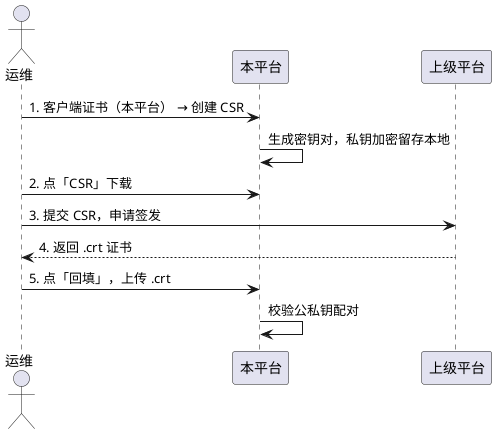

<!-- GB35114 使用说明 -->

# GB35114 使用说明

本文按**实际操作顺序**讲怎么用：先建 CA，再建本平台自己的身份，然后给下级签发、
向上级申请，最后接入设备与级联。

> 证书体系的设计取舍见 [设计说明](design.md)，部署配置见 [安装说明](install.md)。

---

## 〇、先理解一张表：各类证书是干什么的

进入 **GB35114 证书管理** 页面（左侧菜单），会看到 5 个 Tab。**先分清它们再动手**，
否则最容易犯的错是把"给下级的证书"和"自己的证书"搞混。

Tab 名按**接入方向**分两组，组名就是"谁接谁"：

| Tab | 类型 | 私钥在哪 | 什么时候用 |
|---|---|---|---|
| **CA 证书管理** | 本地根 CA（签发用）+ 受信任的 CA（验链用） | 见 §一 | 最先建，两栏各管一件事 |
| **下级接入 · 服务端证书（本平台）** | 本平台作**平台**（UAS）时的身份，签 `sign2` | **本平台** | 设备要证书双向接入时 |
| **下级接入 · 客户端证书（下级设备）** | 本平台**签发给下级设备/平台**的证书 | 下级 | 每台要接入的设备一张 |
| **上级接入 · 客户端证书（本平台）** | 本平台作**下级**（UAC）时的身份，签 `sign1` | **本平台** | 本平台要向上级注册时 |
| **上级接入 · 服务端证书（上级平台）** | 上级平台的身份，**只有公钥** | 上级 | 本平台要向上级注册时 |

> 括号里的**（本平台）/（下级设备）/（上级平台）说的是"这张证书代表谁"**，
> 也就是私钥在谁手里；前缀的**下级接入/上级接入说的是"这次握手谁主动连谁"**。
> 两者正交，别混：`下级接入 · 客户端证书` 是**下级设备**的身份、私钥在下级设备上，
> 只是它由本平台签发、用于接入本平台。
>
> 名字里的"服务端/客户端"指的是**在握手里的角色**，不是"装在服务器上/装在客户端上"。

> **CA 那一栏是唯一不按接入方向分的**：一张 CA 证书不区分它签的是服务端还是客户端证书，
> 所以两栏按"**是否持有私钥**"分 —— 本地根 CA 持私钥、能签发；受信任的 CA 只有公钥、
> 只参与验链。受信任的 CA 同时服务两个方向（上级平台证书 + 第三方签发的下级设备证书）。

---

## 一、CA 证书管理

**Tab：CA 证书管理**（两栏）

CA 按**是否持有私钥**分两栏，与"服务哪个方向"无关：

| 栏 | `type` 值 | 私钥 | 份数 | 能做什么 |
|---|---|---|---|---|
| 本地根 CA 证书（本平台生成） | `LOCAL_CA` | **本平台持有** | **限一份** | 签发本平台自己的证书与下级设备证书 |
| 受信任的 CA 证书（外部签发，需导入） | `TRUSTED_CA` | 无（仅公钥） | 多份 | 证书链校验：上级平台证书、第三方签发给下级设备的证书 |

### 1.1 本地根 CA 证书

**「生成本地根 CA」**

主题 CN 已按统一规则默认生成 `本平台国标ID_密码模块ID`（见 §4.1），改不改都能建。
CA 表单收的字段与其它证书创建入口**完全一致**：主题 CN + 国家（C）/ 省份（ST）/
城市（L）/ 组织（O）/ 组织单位（OU）+ 有效期（天）+ 备注。

> 这几个 DN 段都不是必填项，但**表单一致**是有意为之：CA 是唯一的、创建后基本不再改，
> 若单独给它一套精简表单，用户会以为 CA 与其它证书"有什么区别"。**落库的各列一律由
> 签出的证书反解析得到**，因此 `subject_dn` 与 `country` 等列永远一致 ——
> 不会出现"DN 里有 `C=CN`、`country` 列却是空"这种同一份数据存两遍还互相矛盾的情况。

生成后列表里会出现这条 CA，「关联证书」列显示它签发了多少张证书，点开可看清单。

> **这一栏只有「生成」，没有「导入」。** 本平台自己生成的 CA 私钥不允许导出（导出只给
> `.crt` 公钥证书），所以也不存在"把 CA 连同私钥搬进来"的场景 —— 与其在界面上摆一个
> 走不通的入口，不如不给。后端的 `importCa(LOCAL_CA)` 及其唯一性守卫仍在，只是界面不再调用。

### 1.2 关于"本地根 CA 只保留一份"

**已有本地根 CA 时，再点「生成本地根 CA」会被拒绝**，提示会点名当前
在用的那一份（如"已存在本地根 CA #1（GB35114-Root），请先删除它再生成"）。

这是有意为之：本地根 CA 是**给本平台自己签发证书的根**，多份并存会让"这张证书是谁签的"
失去意义。轮换路径是**先删旧的、再建新的**：

1. 删除旧 CA —— 若有证书引用它，删除会被拒绝，报错会点名是哪些证书（见 §1.4）；
2. 生成新的 CA；
3. 重新签发所有证书（**先删除、再重新创建**，见 §2.2）。

> **受信任的 CA 不受这个限制**。多个上级平台、多家第三方机构，各导入一份 `TRUSTED_CA`。

### 1.3 受信任的 CA 证书

**「导入受信任的 CA」** —— 导入外部机构签发的 CA 证书，**只保存公钥，不可用于签发**。

它参与**两个方向**的证书链校验：

| 方向 | 何时校验 | 要导入什么 |
|---|---|---|
| 下级设备接入（本平台作 UAS） | **恒开** | 第三方签发给设备的证书，其签发 CA 要导入这里 |
| 上级平台级联（本平台作 UAC） | 由 `gb35114.verify-upstream-cert-chain` 控制，默认**开** | 上级证书的签发 CA 要导入这里；自签的上级证书把它本身导入一份即可。不校验就把该项置 `false` |

> **校验是实时的，没有"导入时标记为可信"这回事**：每次设备/上级注册都重新读取本栏
> 并验签。因此**删除本栏某个 CA 会立刻影响后续接入**，而仍被证书引用的 CA 后端会拒绝删除。
> 反过来，导入顺序也不重要 —— 先导证书、后导 CA 完全可以，设备在 CA 到位后即可接入。

### 1.4 「关联证书」列

两栏的 CA 列表都有这一列，显示该 CA 名下的证书张数，**点开是一份清单**：
类型 / 国标 ID / 主题 CN / 状态 / 签发方式，每行可跳到对应的证书 tab 去处理。

关联由**签发关系**决定（`ca_id`），改不了也无需维护。删除 CA 时若其下仍有证书，
会被拒绝，且报错会**点名是哪些证书**（按类型分组，各举一个国标 ID）——
数字只说明"删不掉"，清单才说明"该去处理谁"。

---

## 二、建立本平台的服务端身份（UAS）

**Tab：下级接入 · 服务端证书（本平台）**

这个身份用于：本平台作平台，接受下级设备/平台的证书注册，在 200 OK 里签 `sign2`。

### 2.1 三种建立方式

三条路产出的都是同一件事（本平台持有私钥的一组服务端身份），按现场条件选一条：

| 方式 | 按钮 | 适用 |
|---|---|---|
| 一步创建 | 「创建服务端证书」 | **最省事，推荐先用这个跑通**。一个请求里完成：生成密钥对 + 当场签发。签发者选本地根 CA，不选则自签 |
| CSR → 本平台签发 | 「创建 CSR」，再在列表行点「签发」 | 需要**留存 CSR**、或签发动作要另行审批时用它。私钥在生成 CSR 时已加密留存，签发是**原地更新同一条记录**（不新建行 —— 设备与级联平台绑定的是记录 ID） |
| 回填 / 导入 | 列表行点「回填」，或「导入（证书+私钥）」 | 证书**已由外部机构签好**。回填是往已有 CSR 记录上贴证书；导入是连私钥一起收进来。两条路后端都会**校验公私钥配对**，不配对拒绝 |

> **三条路共用同一把锁**：服务端只保留一组密钥对，已存在服务端证书（含**待签发**记录）时，
> 三个入口都会被拒绝。命中待签发记录时提示指向「签发」或「回填」并给出记录 ID ——
> 待签发行不是"占用"，而是"还差一步"，删掉重来会白丢一对密钥与一份 CSR。

> 一步创建的**签发方式**是可选的：选一个本地根 CA 就用它签，不选就自签。
> 有本地根 CA 时建议用它 —— 设备侧只需导入一次 **CA 证书**即可验证本平台后续签发的
> 所有证书；自签则设备侧要导入**本平台证书本身**，换发时得重新导入。
> 无 CA 的联调环境用自签即可。CSR 路径的「签发」弹窗同理，`签发 CA` 留空即自签。

> **主题不用自己拼**：表单里的「主题（CN）」已按统一规则默认生成
> `本平台国标ID_密码模块ID`（见 §4.1 的格式说明），国标 ID 自动取自 `sip.id`，
> 密码模块 ID 取自配置 `gb35114.module-id`（留空即 22 个 0）。

> 需要别的名字时直接改主题即可。

> **客户端证书（本平台）不提供一步创建**：那张要交给上级去验 `sign1`，
> 必须由上级签发，只能走「创建 CSR → 导出交上级 → 回填」，见 §4。

### 2.2 ⚠️ 服务端只保留一组密钥对，换发 = 先删除再重新创建

**已经存在一份未吊销的服务端证书时，「创建服务端证书」与「导入」都会被拒绝。**

服务端只保留**一组密钥对**，因此**没有"在原证书上再签一张"这种操作**。
延长有效期、换主题 DN、换签发 CA —— 一律走：

1. 在列表里**删除**现有服务端证书；
2. 点「创建服务端证书」重新创建。

> **注意：新证书是新的密钥对。** 设备侧存的还是旧公钥，所以
> **绑定过它的设备与级联平台需要重新导入本平台证书**才能继续注册。
> 这不是实现上的偷懒 —— 设备只认公钥，密钥对变了就必须重新分发，
> 任何"看起来没变"的做法都只是把这个步骤推迟到设备验签失败的那一刻。

> 删除会被**引用检查**挡住：若该证书仍被设备（`wvp_device.server_cert_id`）
> 或级联平台（`wvp_platform.platform_cert_id`）绑定，后端拒绝删除并点名是哪个设备/平台。
> 先在这些设备/平台的编辑页解除绑定，再删证书。
> 这条检查是为了让问题在**删除时**就暴露 —— 否则它会一路潜伏到设备注册，
> 表现为一个和证书八竿子打不着的 403。

### 2.3 服务端证书只有一张

`SERVER_IDENTITY`（服务端证书（本平台））**由后端强制唯一**：已有未吊销的一张时，
「创建服务端证书」与「导入」入口都会被拒绝，换发路径是**先删除、再重新创建**（§2.2）。

因此**页面上没有「设为默认」**，也不需要 —— 不存在"选哪张"的问题。

- 设备未绑定具体证书时，UAS 握手用这一张的密钥对签 `sign2`；
- **证书唯一性是按"未吊销"判定的**，所以过期不会解锁新建（过期 ≠ 吊销）；
- 存量环境里可能留有同一密钥组的多张证书（历史版本的产物），
  此时列表会全部显示，UAS 签名仍按密钥组内的可用证书顺延。

> 例外情况：某台设备信任的**不是**平台当前签名身份（比如换过密钥对但没重新配置该设备），
> 在**设备编辑页**给它单独绑定 `server_cert_id` 即可，不影响其它设备。

### 2.4 应急：密钥泄露 / 私钥丢失

「服务端只保留一组密钥对」的守卫挂在"**未吊销**"上，留了一条应急通道：
把该组证书**全部吊销**，守卫随即失效，即可新建第二组密钥对。

> 但**页面上没有「吊销」按钮**（见 §7.1）：界面只给「删除」。
> 于是应急路径改成 —— 先在**设备编辑页 / 级联编辑页解除绑定**，再删除该证书，
> 守卫同样失效。多一步解除绑定，换来的是不出现"已吊销的占位记录还占着引用"这种中间态。
>
> 若现场确实需要"不解除绑定就立刻停用"（例如私钥已泄露、要抢在换绑之前先断掉签名能力），
> 可以**直接调后端接口** `POST /api/gb35114/cert/revoke/{id}` —— 它仍在，只是没有界面入口。

---

## 三、给下级设备签发客户端证书

**Tab：下级接入 · 客户端证书（下级设备）**

两种方式：

| 方式 | 按钮 | 说明 |
|---|---|---|
| 由下级 CSR 签发 | 「由下级 CSR 签发」 | **推荐**。把设备的 CSR 粘进来，选本地根 CA，填国标 ID |
| 导入下级证书 | 「导入下级证书（.crt）」 | 下级已有证书（由别的 CA 签发），仅登记公钥 |

签发完成后点「证书」下载 `.crt` 交付给设备。

> **导入第三方签发的证书时还有一步**：把签发它的 CA 导入
> **CA 证书管理 → 受信任的 CA 证书**。少了这一步，设备注册时链校验不通过，仍会被拒。
> 导入时若签发者尚未导入，页面会弹一条**不拦截**的提示告诉你这件事 ——
> 可以先导证书、后导 CA，顺序不限。

**「关联设备」列**会显示这张证书实际被哪台设备使用了（按国标 ID 匹配 `wvp_device`）。
显示"未接入"表示该设备还没注册上来。点击可跳转到设备列表。

### 续期：用同一份 CSR 再签

列表里 `状态` 列会标出「已过期」。续期时**不要重新生成 CSR** ——
重新生成会得到新的密钥对，设备侧要重新导入。正确做法是用「由下级 CSR 签发」
填入**原来那份 CSR**，或者直接用签发时的记录。

> 只要密钥对不变，设备无需做任何改动。

### 停用：删除证书

**没有「吊销」按钮 —— 用「删除」停用**，删除后该设备立即无法接入：

- 设备持该证书注册 → 被拒，日志给出"本平台未给该设备签发过客户端证书"；
- 设备**自报旧证书**（在 `Capability` 的 `cnonce` 里）→ 同样被拒。
  这条路径不过数据库，平台会按公钥指纹反查 —— **查不到记录即拒绝**。

> 为什么删除与吊销等价：指纹反查这道闸问的是"本平台有没有给这台设备签发过这张证书"。
> 命中一条 `revoked=true` 的记录是"没有（已作废）"，压根查不到记录也是"没有" ——
> 两条路都通向拒绝接入。既然结论一样，界面就只留一个入口，省掉"吊销了但记录还在"
> 这个既占着引用守卫、又要额外解释的状态。

> **仍被设备绑定时删不掉**：删除前会校验 `wvp_device.cert_id` 等引用，
> 被引用则拒绝并点名是哪台设备（见 §2.2）。请先在该设备的编辑页解除绑定。

> 设备自报旧证书的路径**不受"过期是否拒绝"开关影响** —— 任何配置下都拒绝。

---

## 四、建立本平台的下级身份（UAC）—— 向上级注册时用

**Tab：上级接入 · 客户端证书（本平台）**

用于本平台作下级、向上级平台注册时签 `sign1`。这个证书**通常由上级平台签发**。

### 4.1 标准流程（由上级签发）



**私钥全程不出本平台**，只把 CSR（含公钥）交出去。

#### 主题 CN 的格式（GB 35114—2017 附录 A 表 A.1）

设备证书的 CN 有**标准规定的格式**，不是随便填的名字：

> **设备 ID_密码模块 ID**，ID 间以「`_`」分隔，某个 ID 为空时值为「**NULL**」。

**所有证书的主题都按这个格式默认生成**，表单里只留一个「主题（CN）」：

```
本平台国标 ID_0000000000000000000000
                └── 22 位密码模块 ID，默认全 0，可用 gb35114.module-id 配置
```

| 主题的组成 | 来源与规则 |
|---|---|
| 设备 ID 段 | **自动取本平台国标编码**（`sip.id`）。接入上级时若本平台编码与上级侧已有编码冲突，可直接改主题里的这一段 —— 标准只要求"能唯一标识"，不要求必须等于本平台在本地用的编码 |
| 密码模块 ID 段 | **22 位十进制**，规则见附录 B：产品型号 4 位 + 类型 2 位 + 生产日期 8 位（YYYYMMDD）+ 批次 3 位 + 序号 5 位。**默认 22 个 `0`**（本平台没有硬件密码模块）；现场若有已备案的密码模块编号，改配置项 `gb35114.module-id` 即可，见 §9.7 |

> **为什么服务端证书与根 CA 也用这个格式**：三者都是本平台自己签发的证书身份，
> 主题格式没有理由各不相同。注意这只是一种**沿用**：附录 A 约束的是**设备证书**，
> 本平台自身证书的主题并不受它约束，因此想改成别的名字也可以。

> 位数不对的密码模块 ID 会在**创建时**就被后端拒绝。这一步拦下来是有意的：
> 证书一旦由上级签出就固化了，格式问题只能靠重签解决，而 CSR 是最便宜的拦截点。
>
> 配置项里填错了**不会**被悄悄改写成全 0 —— 原样下发到页面，由页面提示。
> 改写会让"配置写错了"这件事在界面上消失，运维改了个错值却看到合规的样子，反而查不出问题。

### 4.2 证书在「国标级联 → 编辑」页上办

**新增上级时选不了证书** —— 证书槽要写"本上级的 ID"进引用列，而新增时上级还没有 ID，
只能先落一张游离证书。所以：

- **新增上级**：`注册方式` 照常可选 1 / 2 / 3 / 4。选 3 / 4 时页面给一条提示，
  指向"保存后到编辑页配证书"，**不阻断提交**；
- **保存后**：到 **国标级联 → 编辑**，两个证书槽才出现。

> **没配证书就不注册**：新增时选了 3 / 4 且 `启用` 为开，平台不会立刻发注册
> —— 此刻证书还没配，注册必然失败（本平台拿不出 `sign1` 的密钥）。
> 日志记一条 `[新增平台] GB35114 证书未配置，暂不注册，请在编辑页配置后保存`，
> 配好证书再保存（`update`）即正常注册。

### 4.3 编辑页的两个证书槽

| 槽 | 对应 `type` | 操作 | 落到哪一列 |
|---|---|---|---|
| **国密设备证书** | `DEVICE_IDENTITY` | 空态 → `创建 CSR`（弹对话框）；待签发 → `导出 CSR` / `回填`；已签发 → 证书摘要 + `导出证书` / `删除` | `wvp_platform.device_cert_id` |
| **上级平台证书** | `TRUSTED_PLATFORM` | 空态 → `导入上级证书`；已导入 → 证书摘要 + `导出证书` / `删除` | `wvp_platform.platform_cert_id` |

**`创建 CSR` 弹出的对话框与「GB35114 证书管理」页的同名对话框一致** ——
同一件事两个入口，长得不一样只会让人以为做的事不一样。字段：主题（CN）、
国家 / 省份 / 城市 / 组织 / 组织单位、有效期（天）、备注。

主题**默认填「本平台在该上级处的国标 ID\_密码模块 ID」**：

- 国标 ID 优先取 **SIP 认证用户名**（`username`），这是上级用来认本平台身份的字段；
  页面上它由「设备国标编号」自动带出（改设备国标编号会同步过来），也可以单独改；
- 密码模块 ID 取自配置 `gb35114.module-id`，留空即 **22 个 0**（见 §9.7）；
- **两个值都可以当场改** —— 接入多个上级时本平台可能需要另编编码防冲突。
  密码模块 ID 段位数不对时页面会提示（只提示，权威校验在后端创建时）。

外加一个可选的 `导入 CA`（类型 `TRUSTED_CA`）。**本页只导不删** ——
删除入口仍在 **GB35114 证书管理 → CA 证书管理**。重复导入同一张 CA 会被静默接受。

每个动作**即时落库**，不依赖点「保存」：

- `创建 CSR` 返回的 ID **立刻**写进本上级的 `deviceCertId`；
- `导入上级证书` 同理写进 `platformCertId`。

落库走的是**只写绑定那一列**的专用接口（`POST /api/gb35114/cert/bind-platform`），
不是整行「保存」：

> **为什么不搭整行保存的车**：编辑页拿到的是**列表行对象本身**（`editPlatform(row)`
> 直接赋值），只改内存会让人以为绑上了 —— 一刷新就没了，而库里那两列始终是 `NULL`。
> 整行保存也不合适：它要过 `uk_platform_unique_server_gb_id` 等前置校验，
> 校验一失败绑定就跟着一起丢，页面上同样看不出来。绑定是证书槽自己的动作，单独落库。

因此中途放弃表单也不会留下悬空引用，只会多一张能在证书管理页看到的证书。

> `创建 CSR` 之后证书处于**待签发**态（有 CSR、无证书）。跨天等上级签发是正常的，
> 回来点 `回填` 上传上级签回的 `.crt` 即可；也可以到
> **GB35114 证书管理 → 上级接入 · 客户端证书（本平台）** 那一栏收尾（见 §四）。
> 证书摘要形如 `#63 34020000002000000001_NULL [有效]` —— 主题 CN 可能长达 44 字符
> （国标 ID\_22 位密码模块 ID），故截断显示，**悬浮可看全**（完整 CN、国标 ID、
> 签发来源、有效期）。状态标 `待签发` / `已过期` / `有效` 三种。

> **`删除` 与列表页的「删除」不同**：证书此刻正被**本上级**按 ID 引用，
> 直接删会被引用守卫拒绝。这个按钮先把 `wvp_platform` 的对应引用列置空、再删除。
> 若还被**别的**上级或设备引用，照旧拒绝并点名 —— 那说明该先处理那个引用方。
> 它**只解绑级联平台，不动设备**：设备侧那张证书与级联无关，擅自解绑会把一台
> 正常在用的设备弄成"未配置证书"。

**上级平台证书的签发者未导入时，槽下方会常驻一条橙色告警。** 判据与证书管理页
「签发方式」列完全一致（有证书、非自签、`ca_id` 为空）：

- 链校验开着（默认）→ 告警说「**级联注册会被拒**」，并指出签发者 DN；
- 链校验被关掉（`verify-upstream-cert-chain: false`）→ 告警改说「当前不影响注册，
  但该项改回 true 就会断链」—— 关着的时候说"会被拒"是虚警，会把人引去排查一个
  不存在的故障。

导入那一刻后端也会给一次同样的提示（`$notify`，不阻断导入），但那是一次性通知，
划过去就没了；而这个问题真正发作是在几天后的一次级联注册被拒上。故在编辑页常驻。

### 4.4 归属：证书与上级是绑定关系，打开编辑页即自动补齐

**两个证书槽里的证书只服务于这一个上级** —— 设备证书是按本上级的认证用户名申请的
（上级认的就是这个身份），上级证书是从该上级导出、只用来验它的 `sign2`。
因此它们与上级是**独占**的绑定关系，不是"谁都能用"的公共资源。

这个关系存在 `wvp_platform` 的两个外键上（`device_cert_id` / `platform_cert_id`），
**打开编辑页时自动补齐**：

- 若某槽还没有绑定，但按国标 ID 能**唯一**定位到一张同类型证书，页面立刻把它绑上
  （走 `POST /api/gb35114/cert/bind-platform`，只写绑定列），槽里随之显示该证书；
- 之所以要落库而不停留在"运行期靠国标 ID 匹配"：匹配是**兜底**，它的前提是"该类型
  只有一张"。接入第二个上级后这个前提就没了 —— 那时要么匹配到错的那张，
  要么匹配不到，而**注册失败的原因只出现在日志里**。绑进库里，归属才是确定的。

| 库里的绑定列 | 按国标 ID 能解析到 | 槽里显示 | 说明 |
|---|---|---|---|
| 有值 | — | 那张证书的摘要 | 正常态 |
| `NULL` | 唯一一张 | 该证书摘要（**页面已自动绑定并落库**） | 打开页面即收敛为上一行 |
| `NULL` | 匹配到多张 | 空态 **+ 橙色提示** | 后端拒绝猜测，注册会因取不到证书而失败，需手工绑 |
| `NULL` | 一张都没有 | 空态（`创建 CSR` / `导入上级证书`） | 确实缺证书 |

> **多候选时页面不猜** —— 猜错比不显示更糟：显示的和真正拿去签 `sign1` 的可能不是
> 同一张。这时橙色提示要求人工指定，判据与后端 `resolveByType` 一致
> （按 `gb_id` 精确匹配 → 匹配不到且唯一候选才兜底 → 多候选返回 `null`）。

> 本平台作为下级可以**同时接入多个上级**，每个上级绑自己的一张 `DEVICE_IDENTITY`
> 与 `TRUSTED_PLATFORM`。自动绑定让多上级场景不需要人工逐条指定 —— 前提是每个上级的
> 证书都按各自的国标 ID 申请/导入（这也是 `创建 CSR` 默认填本上级国标 ID 的原因）。

### 4.5 删除上级时证书怎么办

**删上级 → 连带删它绑的那两张证书。** 绑定关系存在 `wvp_platform` 的两个外键上，
上级行一删，证书就再没有归属，留着只会在证书管理页堆成看不出归属的孤儿记录。

- **只删被绑的那两张**，其余证书不动；
- **某张删不掉不影响删上级**：存量数据里可能两个上级指向同一张证书，先删的那个会被
  引用守卫拒绝 —— 这是正确的判定，但不会把已经成功的"删上级"一起回滚，日志里记一条
  `[删除平台] 连带删除 GB35114 证书 #N 失败，已跳过`；
- **CA 永不随上级删除**：CA 是全局的（§一），删完上级它仍在
  **CA 证书管理 → 受信任的 CA 证书** 里，其它上级还要用。

---

## 五、导入服务端证书（上级平台）

**Tab：上级接入 · 服务端证书（上级平台）**（只读总览）

把上级平台的证书（`.crt`，**只有公钥**）导入，用于校验上级在 200 OK 里签的 `sign2`。

- **导入入口在「国标级联 → 编辑」页的证书槽**（§4.3）—— 在那里导，ID 直接落到该上级行；
- 本 Tab 保留列表与行内 `导出证书` / `删除`，用于**跨天收尾**与总览「这张证书被哪个
  上级用了」（`关联平台` 列）；
- 上级证书的**签发 CA** → 到 **CA 证书管理 → 受信任的 CA 证书** 点「导入受信任的 CA」
  （类型 `TRUSTED_CA`，可多份）。只有开启链校验时才需要，见下。

**导入时会提示签发者是否已在本平台留存**，但**不阻断** —— "证书先导、CA 后导"是合法顺序：

| 情形 | 提示 |
|---|---|
| 签发它的 CA 已导入 | 无 |
| 有 CA，但都不是它的签发者 | 「这张证书不是由任何已导入的 CA 签发的。请让上级用你已导入的 CA 重新颁发，或导入签发它的那张 CA。」 |
| 一张 CA 都没有 | 「尚未导入任何 CA，无法校验签发链。请先导入上级的 CA。」 |

真正的信任判定由注册时的证书链校验实时承担，不由导入时这一句提示决定。

> **本平台默认校验上级证书链**（`gb35114.verify-upstream-cert-chain` 默认 `true`）。
> 上级证书必须能由某个已导入的**受信任的 CA** 签发 —— 自签的上级证书（现场最常见）
> 要把它**本身**也以「受信任的 CA」身份导入一份，否则级联注册会被拒。
>
> 需要放宽时把该项置为 `false`：**只关上级方向**，设备方向的链校验照旧恒开。
> 该状态下国密证书管理页顶部会显示一条黄色告警，提示当前处于放宽状态。
>
> 拿不到 CA 时还可以用全局逃生口 `gb35114.skip-cert-chain-verify`（两个方向一起放行），
> 详见 §7.4。

---

## 六、接入设备

### 6.1 设备侧配置

在摄像机/下级平台上配置：

- 平台 SIP 地址与端口；
- **平台国标编码** —— 必须是 wvp 的 `sip.id`（如 `35020000002000000001`），
  不是 `user-settings.server-id`（那是集群内节点标识，默认 `000000`）。
  握手里设备签 `sign1` 用的就是它，不一致会报 `server id mismatch`；
- **平台证书** —— 导入 §2 里那张**默认**服务端证书的公钥；
- **设备自己的证书与私钥** —— 用 §3 签发的那张；
- 认证方式选**证书双向认证（Bidirection）**。

### 6.2 平台侧

设备注册上来后，wvp 会**自动识别并落库**：

- 国密注册分支是靠请求头 `Authorization` 的 scheme（`Capability` / `Bidirection` /
  `Unidirection`）识别的，**不依赖预先配置**，因此设备主动注册也能直接接入；
- 落库时会把 `register_way` 固化为 `3`（双向）或 `4`（单向）。

在**设备编辑页**可以：

- **注册方式** —— 选「证书双向认证（GB35114）」或「证书单向认证（GB35114）」；
- **服务端证书** —— 指定该设备信任的 `server_cert_id`（留空则跟随平台默认服务端证书）。
  摄像头只信任某一张特定证书时在这里绑定。

平台签 `sign2` 用的私钥必须与摄像头里导入的平台证书公钥配对，否则摄像头验签失败、
注册后拒绝对信令服务（表现为目录查询 403、通道同步不上）。

### 6.3 灰度与混跑

**Digest 与证书注册可以同时存在**：

- `gb35114.enabled: false` 时整套国密逻辑短路，全部走原 Digest 流程；
- 开启后，**未切换的设备仍走 Digest** —— 判定依据是请求头，不是全局开关。

因此升级可以逐台设备灰度。

---

## 七、策略开关与页面提示

### 7.1 过期策略

证书管理页顶部有一条策略提示（只读），显示当前配置。

| `gb35114.reject-expired-cert` | 行为 |
|---|---|
| `false`（默认） | **过期只标出、不拦截**。列表里该行显示「已过期」tag，鼠标悬停提示"当前不拒绝过期证书，仍可用于签名，建议删除后重新创建"。设备照常注册，日志记 warn |
| `true` | **按日期硬拒绝**。设备/级联被拒，提示"服务器证书 #N 已不可用" |

**为什么默认不拒绝**：过期只在页面标出、不拦截注册。一张刚过期几小时的证书在协议上
**仍然可用**，按日期硬拒绝会让设备在运维还没反应过来时就被挡在门外，而且现场只能翻日志
才看得出原因。

默认策略是"**标出来，让人来决定**"：看到「已过期」后，运维可以选择：

- **删除后重新创建** —— 正常换发路径（§2.2）。**会换密钥对**，设备与级联平台需要
  重新导入本平台证书；
- **删除** —— 明确停用该身份（密钥泄露、证书需要立刻作废时用）。

> 页面上只有「删除」一个入口，没有单独的「吊销」按钮：两者对"能不能接入"是等价的 ——
> 设备自报的证书按公钥指纹反查本表，命中已吊销记录拒绝，**压根查不到记录同样拒绝**。
> 多留一个入口只会造出"记录还在、占着唯一性守卫"这类中间态。
> 后端 `revoked` 位与 `/revoke/{id}` 接口都还在（历史记录里可能已有 `已吊销` 的行），
> 只是页面不再提供吊销动作。**已吊销的记录不受这个开关影响** —— 任何取值下都拒绝。

### 7.2 Note 认证

控制信令的完整性认证，默认开启，一般不用动。现场联调时可用：

- `gb35114.note.enabled: false` —— 判定"对端 4xx 是不是 Note 引起的"；
- `gb35114.note.vkek-form` —— 切 `raw` / `base64` / `hex`，各厂商对 VKEK 文本形式实现不一。

### 7.3 证书链校验

两个方向的处理**不一样**，这是刻意的：

| 方向 | 本平台角色 | 校验对象 | 是否校验 |
|---|---|---|---|
| 设备接入 | 上级（UAS） | 设备证书是否由本平台已导入的 CA 签发 | **恒开** |
| 级联上级 | 下级（UAC） | 上级证书是否由某个已导入的受信任 CA 签发 | 由 `gb35114.verify-upstream-cert-chain` 控制，默认**开** |

**两个方向用的是同一个候选 CA 集合**：本地根 CA + 受信任的 CA。因此第三方机构签发给
下级设备的证书，只要把签发它的 CA 导入「CA 证书管理 · 受信任的 CA 证书」，设备方向
**不需要任何额外开关**就能通过 —— 设备侧的链校验本来就是恒开的。

**为什么设备侧恒开、级联侧默认开**：GB/T 43026—2023 附录 B 表 B.1 里
「需验证证书链是否正确」只出现在序号 3、6、7 —— 即 7.2 与 7.4（设备身份认证）；
序号 8、9（7.5 上联/下联，即平台间认证）的备注列是**空的**。标准对平台间认证没有链校验
**要求**，但"没有要求"不等于"应当关掉" —— 本平台默认仍从严，因为关掉它意味着任意一张
证书都能冒充上级。需要放宽的现场把`verify-upstream-cert-chain` 置 `false` 即可，
这是**只关上级方向**的精确开关。

**设备侧链校验做什么**：在原有的「按公钥指纹反查签发记录 + 吊销/过期」之外**叠加**一步
「这张证书是否确由本平台已导入的某张 CA 签发」。两者回答不同问题，缺一不可：

- 只看指纹的漏洞：设备拿自己的私钥自签一张证书，只要公钥与库里那张相同，指纹就命中、
  记录也有效 → 被放行。补上链校验后，自签证书验不过任何已导入 CA 的公钥，会被拒。
- 只看链校验的漏洞：链校验只回答"谁签的"，不回答"本平台认不认这把公钥"。因此
  **指纹反查这道闸保留** —— 第三方签发的设备证书仍要先导入本平台（见 §三）。
  两件事是「**导入并绑定**（身份登记）+ **链校验**（签发者可信）」的组合，
  链校验通过不会让一张没登记的证书混进来。

**两个方向都受全局开关 `gb35114.skip-cert-chain-verify` 约束**（默认 `false`）。
CA 拿不到时可用它整体放行，见 §7.4。

**上级证书链校验开着时（默认）要做的事**：把上级那张证书的签发 CA 在
「CA 证书管理 · 受信任的 CA 证书」里导入一份。自签的上级证书（现场最常见）要把
**它本身**导入这一栏 —— 自签走的是「受信任的 CA 列表里存在与它同公钥的一条」这条判据，
所以导入该证书本身即可，不必真去要一张独立 CA。未导入时级联注册会被拒，
且失败信息只出现在本平台的 warn 日志里，现场不容易察觉；国标级联编辑页会为此常驻
一条告警，国密证书管理页的「签发方式」列也会标出「签发者未导入」。

> **本项与设备方向无关**。它只管级联方向；设备方向的链校验恒开，
> 受信任的 CA 一直都在候选集里。这一点常被搞反 —— 看到"设备证书是第三方签的"就去
> 折腾 `verify-upstream-cert-chain`，而真正要做的只是把 CA 导入。

### 7.4 拿不到 CA 时的逃生口

**现象**：设备或上级平台**全部无法接入**，日志里是「本平台未配置任何 CA」「设备证书不是由
本平台已导入的任何 CA 签发」这类信息。原因是链校验要求「这张证书由某张已导入的 CA 签发」，
而那张 CA 现场根本拿不到 —— 上级只发一张证书不给 CA、设备证书由厂商工具签发 CA 不外流、
或 CA 已停用。

**处置**：先看是哪个方向拿不到 CA —— 两个方向有各自的开关，**不要一上来就用全局那个**：

| 拿不到 CA 的方向 | 用什么 | 影响面 |
|---|---|---|
| 只有上级（UAC）方向 | `gb35114.verify-upstream-cert-chain: false` | **只关上级方向**；设备方向的链校验照旧恒开 |
| 上级与设备两个方向都拿不到 | `gb35114.skip-cert-chain-verify: true` | 全局，两个方向一起放行 |

**优先用前一个**：它精确对应"上级不给 CA"这个最常见的情形，不会顺手把设备方向的防护也关掉。
全局开关留给"设备证书的 CA 也拿不到"（厂商工具签发、CA 不外流）这种更彻底的情况。
两者都改完重启生效。

下面说的「打开后」指**全局开关** `skip-cert-chain-verify` 打开后；`verify-upstream-cert-chain`
置 `false` 只影响上级方向，设备方向那几道闸一道不少。

**它关的是「证书链」，不是「签名」**。打开后仍然照常校验：

| 仍然校验 | 说明 |
|---|---|
| 设备证书**指纹反查** | 仍要求命中本平台 `ISSUED_DEVICE` 签发记录（记录被删除同样拒绝） |
| **吊销** | 命中 `revoked` 记录时任何取值下都拒绝 |
| **有效期** | 是否拒绝另由 `reject-expired-cert` 控制 |
| 握手 **SM2 验签**（`sign1`/`sign2`） | 协议层身份认证，与「证书由谁签发」是两件事 |

因此打开后**仍然无法冒充对端** —— 冒充需要对方的私钥。但信任依据退化为
「本平台签发记录存在」（设备方向）与「对端自报的证书可直接使用」（上级方向），
会降低对「证书被替换」的防护（例如设备用同一密钥自签一张证书，指纹反查仍会放行）。

> **这是可用性优先的取舍，不是修复。** 正确做法仍是补齐 CA 后关掉本开关。
> 使用时请记录在案，并在拿到 CA 后尽快恢复 `false`。

### 7.5 验签前的 DN 快速映射（无需配置）

链校验判断「这张证书是否由某张 CA 签发」靠的是一次 SM2 验签。CA 多时逐个试是浪费，
因此实现里先按 DN 缩小候选，**这是纯性能优化，不改变任何判定结果**，也没有配置项。

依据是 X.509 的固有语义：**证书的 `issuer` 必然等于签发它的那张 CA 的 `subject`**。
所以 issuer DN 对不上的 CA 不可能签发者，可以安全排除。比对用 `X500Principal`
（规范化比较）而非字符串，因此不受属性顺序、转义、大小写影响，也绕开了「不同 CA 共用 CN」
的问题 —— 比对的是完整 DN。

**命中为空时会退回原候选集**：`subject_dn` 未回填的存量记录一律保留在候选里，
缩小结果为空时直接用原候选集。缩小只排除「确定不可能」的，不会误伤。

---

## 八、页面列速查

五个 tab 的列是**统一**的：同一概念在各 tab 用同一个列名，同一列在各 tab 含义相同。
只有列名随对象变化 —— `gb_id` 在不同 tab 指不同的对象，列名必须跟着变。

| 列 | 本地根CA | 本地服务端 | 下级客户端 | 本地客户端 | 上级服务端 | 受信任CA |
|---|:--:|:--:|:--:|:--:|:--:|:--:|
| `ID` | ✓ | ✓ | ✓ | ✓ | ✓ | ✓ |
| `关联设备` | | | ✓ | | | |
| `关联平台` | | | | ✓ | ✓ | ✓ |
| `关联证书` | ✓ | | | | | ✓ |
| `下级客户端编码` | | | ✓ | | | |
| `上级平台编码` | | | | | ✓ | |
| `主题（CN）` | ✓ | ✓ | ✓ | ✓ | ✓ | ✓ |
| `密码模块 ID` | | | ✓ | | | |
| `签发方式` | | ✓ | ✓ | ✓ | ✓ | |
| `状态` | | ✓ | ✓ | ✓ | ✓ | |
| `公钥指纹` | | ✓ | | | | |
| `失效时间` | ✓ | ✓ | ✓ | ✓ | ✓ | ✓ |
| `备注` | ✓ | ✓ | ✓ | ✓ | ✓ | ✓ |
| `操作` | ✓ | ✓ | ✓ | ✓ | ✓ | ✓ |

逐列说明：

| 列 | 含义 |
|---|---|
| `下级客户端编码` / `上级平台编码` | 都是 `gb_id`，但指的对象不同：被签发设备或下级平台的编码／上级平台的编码。**同一个字段在不同 tab 指不同对象，所以列名必须分开** |
| `主题（CN）` | 证书主题的 CN。鼠标悬停显示**完整主题 DN** —— DN 只是比 CN 多几个段，单独占一列在联调环境里两列内容完全一样，收进 tooltip 更省地方 |
| `密码模块 ID` | **只在「客户端证书（下级设备）」出现**。取自证书主题 CN 中「`设备ID_密码模块ID`」的后半段（附录 B 的 22 位编码）。<br>GB/T 43026—2023 表 4 序号 1「设备身份管理」要求平台能查看**设备 ID、其密码模块 ID 与设备证书的对应关系** —— 设备 ID 与证书各已有列，单列出模块 ID 才凑齐这一组；该段为 NULL 时显示 `-` |
| `签发方式` | 见下方"签发方式的五种取值" |
| `状态` | 已吊销 / 已过期 / 即将过期（30 天内）/ 待签发。**"有效"是常态，不再出标签** —— 整列绿字只是噪音；该列有值时就是需要处理 |
| `公钥指纹` | SM3 公钥指纹，**只在「服务端证书（本平台）」出现**。相同 = 同一个签名身份、证书彼此可互换，这是判断"哪几张证书对设备等价"的唯一依据。其余 tab 的证书不参与顺延，指纹没有用途 |
| `失效时间` | 已过期标红、即将过期标黄，并附「剩余 N 天」 |
| `关联设备` | 客户端证书（下级设备） → 实际使用它的设备；未接入显示灰字 |
| `关联平台` | 客户端证书（本平台） / 服务端证书（上级平台） → 绑定它的级联平台；受信任 CA → 由它签发的证书所服务的级联平台 |
| `关联证书` | 两张 CA 表都有。显示该 CA 名下的证书张数，点开是清单（类型 / 国标 ID / 主题 CN / 状态 / 签发方式），每行可跳到对应 tab。关联由签发关系（`ca_id`）决定，不区分方向 —— 一张 CA 既可能签了上级平台证书，也可能签了下级设备证书 |

**签发方式的五种取值**（把"由哪个 CA 签发"直接显示到 ID 与 CN，不只是"CA 签发"）：

| 显示 | 含义 |
|---|---|
| `待签发` | 只有 CSR 与私钥，还没有证书 |
| `本地根 CA #1（GB35114-Root）` | 由本地根 CA 签发 |
| `受信任的 CA #7（LiveGBS CA）` | 由已导入的受信任 CA 签发 |
| `自签` | 证书由它自己的私钥签署（issuer 与 subject 相同） |
| `签发者未导入` | 证书由某个本平台没留存的外部 CA 签发。**证书本身可用**，但注册时链校验不通过；把对应 CA 导入「CA 证书管理 · 受信任的 CA 证书」后即自动关联 |

> 在**客户端证书（本平台）** tab，`本地根 CA` 与 `自签` 会标成红色：本平台作客户端时证书必须由上级签发，
> 本地签出来的一律会被上级拒绝，而失败只出现在上级、本平台日志一切正常。

### 8.1 页面上不再出现的字段

这些字段**仍然存在**（部分参与证书生成），只是不再占一列 —— 不展示不等于可以删：

| 字段 | 为什么不再展示 |
|---|---|
| `默认`（服务端证书） | 该列已随「服务端证书后端强制唯一」一并删除。只有一张，没有可标记的对象 |
| `私钥` | 只加密保存，永不下发。列表里服务端/客户端证书一律有私钥（本平台持有），对端证书一律没有 —— 这一列不承载信息 |
| `密钥用途` | **不参与任何判定**，只在签发时写进 X.509 扩展。签发表单也一并去掉，固定用 GB35114 要求的 `digitalSignature` |
| `使用中`（本地根CA） | 删除 CA 时后端会校验引用并拒绝并点名是哪些证书，「关联证书」列已能点开看清单，不必再单独标一遍 |
| `完整主题 DN` | 并入「主题（CN）」的 tooltip |
| `序列号` | 不参与任何判定，展示它会诱导用错依据。需要时导出证书自己看 |
| `CA 名称` | 已废弃。CA 的身份就是它证书的主题 CN，另起一个别名只会让同一张 CA 有两个都像名字的字段 |

> **私钥永不下发**：`key_pem` 带 `@JsonIgnore`，任何 API 响应里都不含私钥；
> 导出功能只提供证书（公钥部分）与 CSR。私钥以 AES-GCM 加密存储在与 CSR 相同的记录中，
> **删除该记录即删除私钥**。

---

## 九、常见问题排错

### 9.1 设备注册不上

先看 wvp 日志里 `[GB35114注册]` 这一行，它直接给出原因：

| 日志 | 原因与处理 |
|---|---|
| `device cert (本平台未给该设备签发过客户端证书)` | 还没在 §3 给这台设备签发证书 |
| `device cert (已被吊销（#N 等）)` | 该记录被吊销了（历史数据，或直接调了 `/revoke/{id}`）。删除该记录后重新签发 |
| `device cert (证书有效，但与本平台签发给 X 的证书不匹配)` | 设备用的证书不是签发给它的那张（国标 ID 对不上） |
| `security35114: verifying sign1` | 设备签的 `sign1` 验不过 —— 检查平台国标编码是否配成了 `sip.id` |
| `security35114: server id mismatch` | 同上，`serverid` 不一致 |
| `服务器证书 #N 已不可用` | 该证书被删除/吊销，或（`reject-expired-cert: true` 时）已过期 |
| `401` 反复出现 | 见 §9.2 |

### 9.2 401 挑战环路

**现象**：日志里 401 每秒出现多次，SIP 线程被打满。

**原因**：国密握手第一包（`Capability`）被对端反复回 401。

**处理**：`RegisterResponseProcessor` 已加限流（同一 CallId 超过 3 次挑战即放弃），
不会无限空转。若仍频繁出现，检查设备是否支持证书注册、平台证书是否配对。

### 9.3 注册成功、目录能拿到，但一点播就 Forbidden

**原因**：出站信令没带上 `Note`。点播类信令的 `To` 头指向**通道**而非设备，
而 VKEK 是按**设备编码**缓存的，直接查会落空。

**处理**：代码已按通道反查所属设备取 VKEK。若仍出现，看日志里
`[GB35114] 出站加签跳过 method=..., to=...：未找到该对端的 VKEK` ——
说明该对端还没完成握手，或 VKEK 缓存被清。

### 9.4 入站请求被回 403

**原因**：`Note` 验签失败。日志有 `[GB35114] 入站 Note 验签失败, peer=..., date=...`。

**处理**：按顺序试

1. `gb35114.note.vkek-form` 切 `base64` / `hex`（各厂商对 VKEK 文本形式实现不一）；
2. `gb35114.note.enabled: false` 关掉，确认 403 是否消失 —— 消失则确认是 Note 引起；
3. 用抓包工具比对平台与设备两侧参与摘要的 `Date` / From / To / CallId / body 是否一致。

> 无 `Note` 的请求是**放行**的（兼容混跑 Digest 的平台），
> 只有"带了 Note 但验不过"才拒绝。

### 9.5 级联注册失败

| 检查项 | 说明 |
|---|---|
| 客户端证书（本平台） | 是否已创建/导入，且**记录仍在、未吊销**（删除或吊销后 `loadIdentity` 直接抛错） |
| 服务端证书（上级平台） | 是否已导入 —— 缺了它无法验 `sign2` |
| 级联编辑页绑定 | 两个证书槽是否都已配好（多上级时务必逐条配） |
| 新增时选了 3/4 但没配证书 | 平台**不会**发注册（日志：`[新增平台] GB35114 证书未配置，暂不注册`）。到编辑页配好证书再保存 |
| 上级是否回 `serverid` | 部分平台（如 LiveGBS）不回，本平台允许缺失 |

### 9.6 注册周期 / VKEK 更新周期超过 1 天

GB 35114—2017 **6.14.3** 规定「视频密钥加密密钥 VKEK 更新周期不大于 1 天」，
GB/T 43026—2023 **7.13** 表 13 序号 1 把它列为必测项，且测的是**配置值**本身。

本实现里 VKEK 只在注册握手时生成，所以**注册周期就是 VKEK 更新周期**。两侧都会自动钳制：

| 方向 | 现象 | 日志 |
|---|---|---|
| 设备注册到本平台 | 设备请求的 `Expires` 超限时，200 OK 回 86400；库里的 `expires` 也存 86400 | `[GB35114注册] 设备：… 请求注册周期 …s 超过 GB 35114—2017 6.14.3 的 1 天上限，已压至 86400s` |
| 本平台注册到上级 | 保存上级时把「注册周期」钳到 86400；发出注册时再兜底钳一次 | `[国标级联] 上级 … 配置的注册周期 …s 超过 GB 35114—2017 6.14.3 的 1 天上限，已改为 86400s` |

**只对国密接入生效**（`registerWay` 为 3/4）。普通 Digest 注册/级联没有 VKEK，
周期随便填，不受影响。

**为什么不报错拒绝**：超限的存量配置或对端设备请求了超长周期，压到合规值即可继续工作；
拒绝会让原本能跑的接入直接断掉。日志里的 warn 就是给你做合规检查用的。

> 另有一个**已知缺口**：标准 C.6.6.4 h) 的「VKEK 通知」信令（点播中 VKEK 变更时用
> `Message` 通知接收者、点播不中断）本实现尚未做。它不影响 6.14.3 的合规，
> 但若要过 43026 的「VKEK 通知」测试项，需要另做一块功能。

### 9.7 想改证书主题里的密码模块 ID

主题格式是「**设备ID_密码模块ID**」（附录 A 表 A.1 第 6 项），后半段的密码模块 ID
按附录 B 是 22 位十进制。本平台没有硬件密码模块，**默认用 22 个 `0` 占位**。

现场若已有**备案的密码模块编号**（检测时要能拿出"主题里的模块 ID 与备案一致"这个事实），
改配置项即可，不用改代码：

```yaml
gb35114:
  # 22 位十进制；留空即 22 个 0
  module-id: '1234567890123456789012'
```

改完重启，**页面上「创建 CSR」的默认主题会带上它**（国密证书管理页与国标级联编辑页都是）。
已经签出去的证书不受影响 —— 主题在签发时就固化了，要改只能重签。

| 填法 | 结果 |
|---|---|
| 留空 / 不写 | 用 22 个 `0` |
| 合法的 22 位数字 | 原样使用，前后空格会被去掉 |
| 位数不对 / 含非数字 | **原样下发到页面**，不静默改写成全 0 |

> 最后一行是刻意的：静默兜底会让"配置写错了"这件事在界面上消失 ——
> 运维改了个错值、页面显示却合规，反而查不出问题。页面上点「生成 CSR」时会提示
> `主题中密码模块 ID 段须为 22 位十进制数字（附录 B）`，后端创建时也会拒绝。
>
> 该值**只影响默认值**：主题字段本身始终可改，单个证书需要不同的模块 ID 时直接改主题即可。

### 9.8 证书续期后设备要重新配置吗

**要。** 服务端证书的换发是「**先删除、再重新创建**」（§2.2），新证书是**新的密钥对**，
设备侧存的还是旧公钥，因此绑定过它的设备与级联平台需要**重新导入本平台证书**
（用本地 CA 签发的场合，导入一次 CA 证书即可，见 §2.1）。

页面上的删除确认与列表提示都写了这一条 —— 这是设备只认公钥的必然结果，
不是可以绕过的实现细节。

### 9.9 想彻底停用国密

`gb35114.enabled: false` 重启。整套逻辑短路，设备/级联回到 Digest 流程。
数据库里多出的表与列不影响原有功能。

> 注意：如果**设备侧**已经切到证书注册，单靠平台关开关会让它注册不上，
> 需要设备侧同步切回摘要认证。
