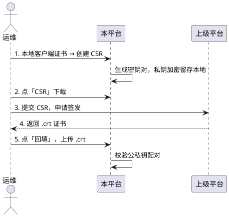

<!-- GB35114 使用说明 -->

# GB35114 使用说明

本文按**实际操作顺序**讲怎么用：先建 CA，再建本平台自己的身份，然后给下级签发、
向上级申请，最后接入设备与级联。

> 证书体系的设计取舍见 [设计说明](design.md)，部署配置见 [安装说明](install.md)。

---

## 〇、先理解一张表：四个用途各是干什么的

进入 **GB35114 证书管理** 页面（左侧菜单），会看到 5 个 Tab。**先分清它们再动手**，
否则最容易犯的错是把"给下级的证书"和"自己的证书"搞混。

| Tab | 用途 | 私钥在哪 | 什么时候用 |
|---|---|---|---|
| **本地CA** | 给本平台自己签发证书的根 CA | **本平台** | 只建一份，最先建 |
| **本地服务端证书** | 本平台作**平台**（UAS）时的身份，签 `sign2` | **本平台** | 设备要证书双向接入时 |
| **下级客户端证书** | 本平台**签发给下级设备/平台**的证书 | 下级 | 每台要接入的设备一张 |
| **本地客户端证书** | 本平台作**下级**（UAC）时的身份，签 `sign1` | **本平台** | 本平台要向上级注册时 |
| **上级服务端证书** | 上级平台的身份，**只有公钥** | 上级 | 本平台要向上级注册时 |

> **"本地"= 私钥在本平台；不带"本地"= 私钥在对方。**
> 名字里的"服务端/客户端"指的是**在握手里的角色**，不是"装在服务器上/装在客户端上"。

---

## 一、建立本地 CA

**Tab：本地CA → 「生成本地根 CA」**

填名称与主题 CN（如 `GB35114-Root`），确定。

生成后列表里会出现这条 CA，`私钥` 列显示"有"。

### 关于"本地 CA 只保留一份"

**已有本地 CA 时，再点「生成本地根 CA」或「导入本地 CA」会被拒绝**，提示会点名当前
在用的那一份（如"已存在本地 CA #1（GB35114-Root），请先删除它再生成"）。

这是有意为之：本地 CA 是**给本平台自己签发证书的根**，多份并存会让"这张证书是谁签的"
失去意义。轮换路径是**先删旧的、再建新的**：

1. 删除旧 CA —— 若有证书引用它，删除会被拒绝（列表里有「使用中」列，标出哪些被引用）；
2. 生成新的 CA；
3. 重新签发所有证书（用「同密钥再签」可以复用密钥对，见 §2.3）。

> **上级 CA 不受这个限制**。多个上级平台可以各导入一份 `TRUSTED_CA`。
> 在「上级服务端证书」Tab 点「导入上级 CA」导入的，就是这一类。

---

## 二、建立本平台的服务端身份（UAS）

**Tab：本地服务端证书**

这个身份用于：本平台作平台，接受下级设备/平台的证书注册，在 200 OK 里签 `sign2`。

### 2.1 三种建立方式

| 方式 | 按钮 | 适用 |
|---|---|---|
| 自签生成 | 「自签生成」 | **最省事，推荐先用这个跑通**。本平台自己生成密钥对并自签一张证书 |
| 创建 CSR → 签发 | 「创建 CSR」→ 列表里点「签发」 | 用本平台的本地 CA 签发（需要 CA 的私钥在本平台） |
| 导入 | 「导入（证书+私钥）」 | 证书和私钥已由外部系统生成好 |

「创建 CSR」若不由本平台签发（要交给外部 CA），流程是：
**创建 CSR → 点「CSR」下载 → 交给外部 CA → 拿到证书后点「回填」上传**。

> 「回填」会校验证书公钥与留存私钥是否配对，不配对直接报错 ——
> 避免出现"私钥和证书不是一对"这种只能靠设备侧报错才发现的问题。

### 2.2 ⚠️ 服务端只保留一组密钥对

**已经存在一份未吊销的服务端证书时，上面三种"新建"入口都会被拒绝。**

提示会引导你使用 **「同密钥再签」** —— 这是**唯一**的换发路径。

### 2.3 「同密钥再签」：换有效期/DN 而不换密钥

在列表里对已有证书点 **「同密钥再签」**，可以：

- 延长有效期（快到期时最常用）；
- 换主题 DN、换签发 CA；
- 保留原密钥对。

**为什么重要**：设备侧只保存平台的**公钥**。同一密钥对签出的多张证书（有效期不同、
签发者不同、序列号不同）对设备**完全等价** —— 设备不需要重新导入任何东西。

反过来，**换密钥对等于悄悄换掉设备信任的公钥**，设备验 `sign2` 必然失败，
而且平台日志上一切正常（确实签了名，只是用错了身份），故障点会漂到设备侧。
所以换密钥对必须由运维显式操作，不能是"新建一张"这种顺手动作的副作用。

### 2.4 「设为默认」

平台可以并存多张服务端证书（同一密钥对的不同"外衣"），`默认` 列标记出
**设备应该导入哪一张的公钥**。

- 设备未绑定具体证书时，UAS 握手用默认证书的密钥对签 `sign2`；
- 默认证书过期时，会自动顺延到**同密钥组**内的其它可用证书，设备无需重新配置；
- **顺延绝不跨密钥组**。

> 多台设备信任不同证书时，在**设备编辑页**逐台绑定 `server_cert_id`，
> 比依赖全局默认更稳。

### 2.5 应急：密钥泄露 / 私钥丢失

「服务端只保留一组密钥对」的守卫挂在"**未吊销**"上，正是为了留这条应急通道：

1. 把该组证书**全部吊销**（列表里点「吊销」）—— 守卫随即失效；
2. 现在可以新建第二组密钥对了。

> 这也是"吊销"该有的语义：它不是"这张纸作废"，而是"**这个身份停用**"。

---

## 三、给下级设备签发客户端证书

**Tab：下级客户端证书**

两种方式：

| 方式 | 按钮 | 说明 |
|---|---|---|
| 由下级 CSR 签发 | 「由下级 CSR 签发」 | **推荐**。把设备的 CSR 粘进来，选本地 CA，填国标 ID |
| 导入下级证书 | 「导入下级证书（.crt）」 | 下级已有证书（由别的 CA 签发），仅登记公钥 |

签发完成后点「证书」下载 `.crt` 交付给设备。

**「关联设备」列**会显示这张证书实际被哪台设备使用了（按国标 ID 匹配 `wvp_device`）。
显示"未接入"表示该设备还没注册上来。点击可跳转到设备列表。

### 续期：用同一份 CSR 再签

列表里 `状态` 列会标出「已过期」。续期时**不要重新生成 CSR** ——
重新生成会得到新的密钥对，设备侧要重新导入。正确做法是用「由下级 CSR 签发」
填入**原来那份 CSR**，或者直接用签发时的记录。

> 只要密钥对不变，设备无需做任何改动。

### 吊销

「吊销」按钮会立即让该设备无法接入：

- 设备持已被吊销的证书注册 → 被拒，日志给出"已被吊销（#N 等）"；
- 设备**自报旧证书**（在 `Capability` 的 `cnonce` 里）→ 同样被拒。
  这条路径不过数据库，平台会按公钥指纹反查吊销状态。

**吊销不受"过期是否拒绝"开关影响** —— 任何配置下都拒绝。

---

## 四、建立本平台的下级身份（UAC）—— 向上级注册时用

**Tab：本地客户端证书**

用于本平台作下级、向上级平台注册时签 `sign1`。这个证书**通常由上级平台签发**。

### 4.1 标准流程（由上级签发）

**私钥全程不出本平台**，只把 CSR（含公钥）交出去。

### 4.2 备选：导入（证书+私钥）

如果上级已经连私钥一起给了（例如上级代生成），用「导入（证书+私钥）」，
平台会校验配对后加密存储。

### 4.3 绑定到级联

签好之后，到 **国标级联 → 编辑** 页面：

- `GB35114 设备证书` 选这张**本地客户端证书**（`wvp_platform.device_cert_id`）；
- `GB35114 上级平台证书` 选上一节导入的**上级服务端证书**（`wvp_platform.platform_cert_id`）。

不绑定时回退到 `application.yml` 里的全局 `gb35114.device-cert-id` / `platform-cert-id`。
**多上级场景务必逐条绑定**，否则所有级联共用一份全局配置，容易选错。

证书下拉里每项都带有效期与状态（如 `· 有效至 2036-09-13 10:00:00` 或 `· 已过期`），
多张证书时靠它区分。

---

## 五、导入上级服务端证书

**Tab：上级服务端证书**

把上级平台的证书（`.crt`，**只有公钥**）导入，用于校验上级在 200 OK 里签的 `sign2`。

- 「导入上级证书」→ 用途 `TRUSTED_PLATFORM`；
- 「导入上级 CA」→ 用途 `TRUSTED_CA`（上级 CA 证书，可多份）。

「关联平台」列显示这张证书被哪个级联使用了。

> **本平台不做证书链校验**。信任关系完全由"运维显式导入"表达 ——
> 导入了哪张公钥，就只认哪张。上级换证书时必须在这里同步导入新证书。

---

## 六、接入设备

### 6.1 设备侧配置

在摄像机/下级平台上配置：

- 平台 SIP 地址与端口；
- **平台国标编码** —— 必须是 wvp 的 `sip.id`（如 `35020000002000000001`），
  不是 `user-settings.server-id`（那是集群内节点标识，默认 `000000`）。
  握手里设备签 `sign1` 用的就是它，不一致会报 `server id mismatch`；
- **平台证书** —— 导入 §2 里那张**默认**服务端证书的公钥；
- **设备自己的证书与私钥** —— 用 §3 签发的那张；
- 认证方式选**证书双向认证（Bidirection）**。

### 6.2 平台侧

设备注册上来后，wvp 会**自动识别并落库**：

- 国密注册分支是靠请求头 `Authorization` 的 scheme（`Capability` / `Bidirection` /
  `Unidirection`）识别的，**不依赖预先配置**，因此设备主动注册也能直接接入；
- 落库时会把 `register_way` 固化为 `3`（双向）或 `4`（单向）。

在**设备编辑页**可以：

- **注册方式** —— 选「证书双向认证（GB35114）」或「证书单向认证（GB35114）」；
- **服务端证书** —— 指定该设备信任的 `server_cert_id`（留空则跟随平台默认服务端证书）。
  摄像头只信任某一张特定证书时在这里绑定。

平台签 `sign2` 用的私钥必须与摄像头里导入的平台证书公钥配对，否则摄像头验签失败、
注册后拒绝对信令服务（表现为目录查询 403、通道同步不上）。

### 6.3 灰度与混跑

**Digest 与证书注册可以同时存在**：

- `gb35114.enabled: false` 时整套国密逻辑短路，全部走原 Digest 流程；
- 开启后，**未切换的设备仍走 Digest** —— 判定依据是请求头，不是全局开关。

因此升级可以逐台设备灰度。

---

## 七、策略开关与页面提示

### 7.1 过期策略

证书管理页顶部有一条策略提示（只读），显示当前配置。

| `gb35114.reject-expired-cert` | 行为 |
|---|---|
| `false`（默认） | **过期只标出、不拦截**。列表里该行显示「已过期」tag，鼠标悬停提示"当前不拒绝过期证书，仍可用于签名，建议吊销后重新颁发"。设备照常注册，日志记 warn |
| `true` | **按日期硬拒绝**。设备/级联被拒，提示"服务器证书 #N 已不可用" |

**为什么默认不拒绝**：A 级握手既不校验证书链也不校验证书有效期，设备只拿公钥验签 ——
一张刚过期几小时的证书在协议上**仍然可用**。按日期硬拒绝会让设备在运维还没反应过来时
就被挡在门外，而且现场只能翻日志才看得出原因。

默认策略是"**标出来，让人来决定**"：看到「已过期」后，运维可以选择：

- **「同密钥再签」** —— 最省事，设备无需改动（推荐）；
- **吊销** —— 明确停用该身份；
- **删除后重新签发** —— 会换密钥对，设备需要重新导入公钥。

**吊销不受这个开关影响**，任何取值下都拒绝。

### 7.2 Note 认证

控制信令的完整性认证，默认开启，一般不用动。现场联调时可用：

- `gb35114.note.enabled: false` —— 判定"对端 4xx 是不是 Note 引起的"；
- `gb35114.note.vkek-form` —— 切 `raw` / `base64` / `hex`，各厂商对 VKEK 文本形式实现不一。

---

## 八、页面列速查

五个 tab 的列是**统一**的：同一概念在各 tab 用同一个列名，同一列在各 tab 含义相同。
只有列名随对象变化 —— `gb_id` 在不同 tab 指不同的对象，列名必须跟着变。

| 列 | 本地CA | 本地服务端 | 下级客户端 | 本地客户端 | 上级服务端 | 上级CA |
|---|:--:|:--:|:--:|:--:|:--:|:--:|
| `ID` | ✓ | ✓ | ✓ | ✓ | ✓ | ✓ |
| `关联设备` | | | ✓ | | | |
| `关联平台` | | | | ✓ | ✓ | ✓ |
| `本平台编码` | | ✓ | | ✓ | | |
| `下级客户端编码` | | | ✓ | | | |
| `上级平台编码` | | | | | ✓ | |
| `主题（CN）` | ✓ | ✓ | ✓ | ✓ | ✓ | ✓ |
| `签发方式` | | ✓ | ✓ | ✓ | ✓ | |
| `状态` | | ✓ | ✓ | ✓ | ✓ | |
| `公钥指纹` | | ✓ | | | | |
| `失效时间` | ✓ | ✓ | ✓ | ✓ | ✓ | ✓ |
| `备注` | ✓ | ✓ | ✓ | ✓ | ✓ | ✓ |
| `操作` | ✓ | ✓ | ✓ | ✓ | ✓ | ✓ |

逐列说明：

| 列 | 含义 |
|---|---|
| `本平台编码` / `下级客户端编码` / `上级平台编码` | 都是 `gb_id`，但指的对象不同：本平台自己的国标编码（`sip.id`）／被签发设备或下级平台的编码／上级平台的编码。**同一个字段在四个 tab 指四样东西，所以列名必须分开** |
| `主题（CN）` | 证书主题的 CN。鼠标悬停显示**完整主题 DN** —— DN 只是比 CN 多几个段，单独占一列在联调环境里两列内容完全一样，收进 tooltip 更省地方 |
| `签发方式` | 见下方"签发方式的五种取值" |
| `状态` | 已吊销 / 已过期 / 即将过期（30 天内）/ 待签发。**"有效"是常态，不再出标签** —— 整列绿字只是噪音；该列有值时就是需要处理 |
| `公钥指纹` | SM3 公钥指纹，**只在「本地服务端证书」出现**。相同 = 同一个签名身份、证书彼此可互换，这是判断"哪几张证书对设备等价"的唯一依据。其余 tab 的证书不参与顺延，指纹没有用途 |
| `失效时间` | 已过期标红、即将过期标黄，并附「剩余 N 天」 |
| `关联设备` | 下级客户端证书 → 实际使用它的设备；未接入显示灰字 |
| `关联平台` | 本地客户端证书 / 上级服务端证书 → 绑定它的级联平台；上级 CA → 由它签发的证书所服务的级联平台 |

**签发方式的五种取值**（把"由哪个 CA 签发"直接显示到 ID 与 CN，不只是"CA 签发"）：

| 显示 | 含义 |
|---|---|
| `待签发` | 只有 CSR 与私钥，还没有证书 |
| `本地 CA #1（GB35114-Root）` | 由本地 CA 签发 |
| `上级 CA #7（LiveGBS CA）` | 由已导入的上级 CA 签发 |
| `自签` | 证书由它自己的私钥签署（issuer 与 subject 相同） |
| `签发者未导入` | 证书由某个本平台没留存的外部 CA 签发。**不影响使用**，只是显示不出归属；把对应 CA 导入「上级 CA」后即自动关联 |

> 在**本地客户端证书** tab，`本地 CA` 与 `自签` 会标成红色：本平台作客户端时证书必须由上级签发，
> 本地签出来的一律会被上级拒绝，而失败只出现在上级、本平台日志一切正常。

### 8.1 页面上不再出现的字段

这些字段**仍然存在**（部分参与证书生成），只是不再占一列 —— 不展示不等于可以删：

| 字段 | 为什么不再展示 |
|---|---|
| `默认`（服务端证书） | 同一密钥对的多张证书公钥相同、对设备完全等价，标哪张都一样。仍可用操作列的「设为默认」按钮指定 |
| `私钥` | 只加密保存，永不下发。"同密钥再签"按钮的显隐已经表达了"这张有没有私钥" |
| `密钥用途` | **不参与任何判定**，只在签发时写进 X.509 扩展。签发表单也一并去掉，固定用 GB35114 要求的 `digitalSignature` |
| `使用中`（本地CA） | 删除 CA 时后端会校验引用并拒绝，页面不必预先标一遍 |
| `完整主题 DN` | 并入「主题（CN）」的 tooltip |
| `序列号` | 不参与任何判定，展示它会诱导用错依据。需要时导出证书自己看 |
| `CA 名称` | 已废弃。CA 的身份就是它证书的主题 CN，另起一个别名只会让同一张 CA 有两个都像名字的字段 |

> **私钥永不下发**：`key_pem` 带 `@JsonIgnore`，任何 API 响应里都不含私钥；
> 导出功能只提供证书（公钥部分）与 CSR。私钥以 AES-GCM 加密存储在与 CSR 相同的记录中，
> **删除该记录即删除私钥**。

---

## 九、常见问题排错

### 9.1 设备注册不上

先看 wvp 日志里 `[GB35114注册]` 这一行，它直接给出原因：

| 日志 | 原因与处理 |
|---|---|
| `device cert (本平台未给该设备签发过客户端证书)` | 还没在 §3 给这台设备签发证书 |
| `device cert (已被吊销（#N 等）)` | 证书被吊销了，重新签发 |
| `device cert (证书有效，但与本平台签发给 X 的证书不匹配)` | 设备用的证书不是签发给它的那张（国标 ID 对不上） |
| `security35114: verifying sign1` | 设备签的 `sign1` 验不过 —— 检查平台国标编码是否配成了 `sip.id` |
| `security35114: server id mismatch` | 同上，`serverid` 不一致 |
| `服务器证书 #N 已不可用` | 该证书已吊销，或（`reject-expired-cert: true` 时）已过期 |
| `401` 反复出现 | 见 §9.2 |

### 9.2 401 挑战环路

**现象**：日志里 401 每秒出现多次，SIP 线程被打满。

**原因**：国密握手第一包（`Capability`）被对端反复回 401。

**处理**：`RegisterResponseProcessor` 已加限流（同一 CallId 超过 3 次挑战即放弃），
不会无限空转。若仍频繁出现，检查设备是否支持证书注册、平台证书是否配对。

### 9.3 注册成功、目录能拿到，但一点播就 Forbidden

**原因**：出站信令没带上 `Note`。点播类信令的 `To` 头指向**通道**而非设备，
而 VKEK 是按**设备编码**缓存的，直接查会落空。

**处理**：代码已按通道反查所属设备取 VKEK。若仍出现，看日志里
`[GB35114] 出站加签跳过 method=..., to=...：未找到该对端的 VKEK` ——
说明该对端还没完成握手，或 VKEK 缓存被清。

### 9.4 入站请求被回 403

**原因**：`Note` 验签失败。日志有 `[GB35114] 入站 Note 验签失败, peer=..., date=...`。

**处理**：按顺序试

1. `gb35114.note.vkek-form` 切 `base64` / `hex`（各厂商对 VKEK 文本形式实现不一）；
2. `gb35114.note.enabled: false` 关掉，确认 403 是否消失 —— 消失则确认是 Note 引起；
3. 用抓包工具比对平台与设备两侧参与摘要的 `Date` / From / To / CallId / body 是否一致。

> 无 `Note` 的请求是**放行**的（兼容混跑 Digest 的平台），
> 只有"带了 Note 但验不过"才拒绝。

### 9.5 级联注册失败

| 检查项 | 说明 |
|---|---|
| 本地客户端证书 | 是否已创建/导入，且**未吊销**（吊销后 `loadIdentity` 直接抛错） |
| 上级服务端证书 | 是否已导入 —— 缺了它无法验 `sign2` |
| 级联编辑页绑定 | `设备证书` / `上级平台证书` 两个下拉是否选对（多上级时务必逐条绑） |
| 上级是否回 `serverid` | 部分平台（如 LiveGBS）不回，本平台允许缺失 |

### 9.6 证书续期后设备要重新配置吗

**不需要** —— 前提是用「**同密钥再签**」。设备只认公钥，密钥对没变就不用动。

如果换过密钥对（删除后重新生成），设备必须重新导入新的平台证书公钥。

### 9.7 想彻底停用国密

`gb35114.enabled: false` 重启。整套逻辑短路，设备/级联回到 Digest 流程。
数据库里多出的表与列不影响原有功能。

> 注意：如果**设备侧**已经切到证书注册，单靠平台关开关会让它注册不上，
> 需要设备侧同步切回摘要认证。
